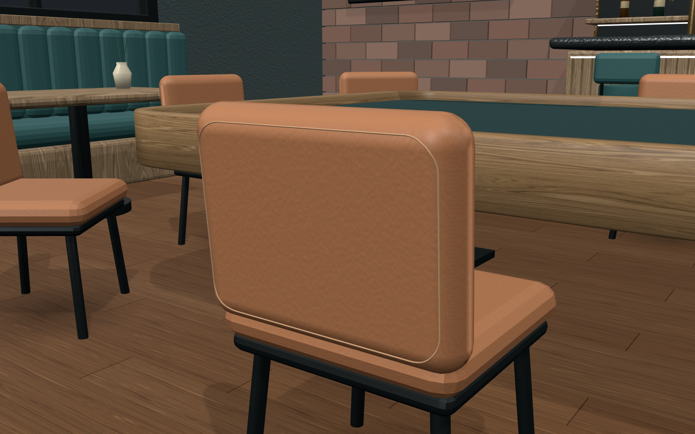
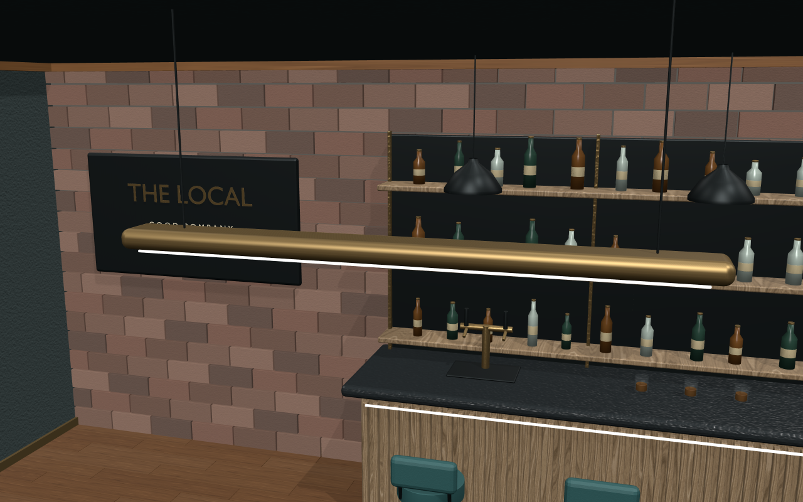
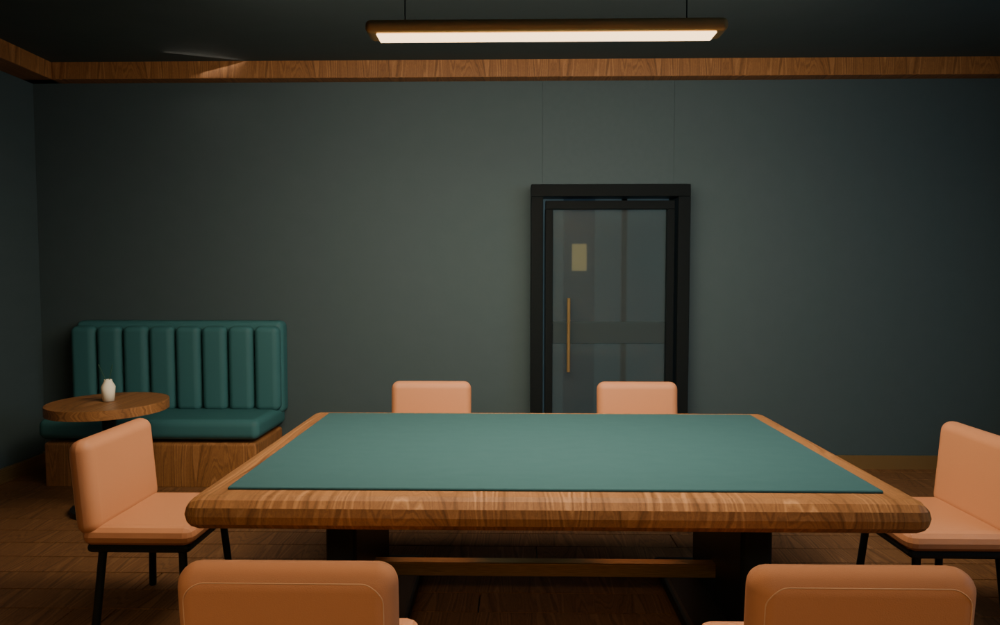
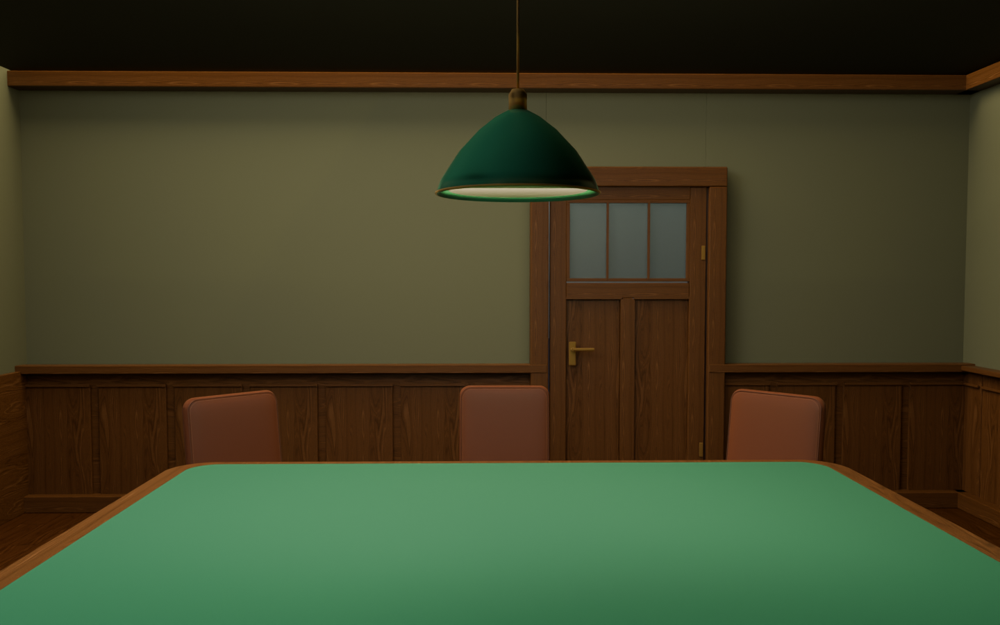
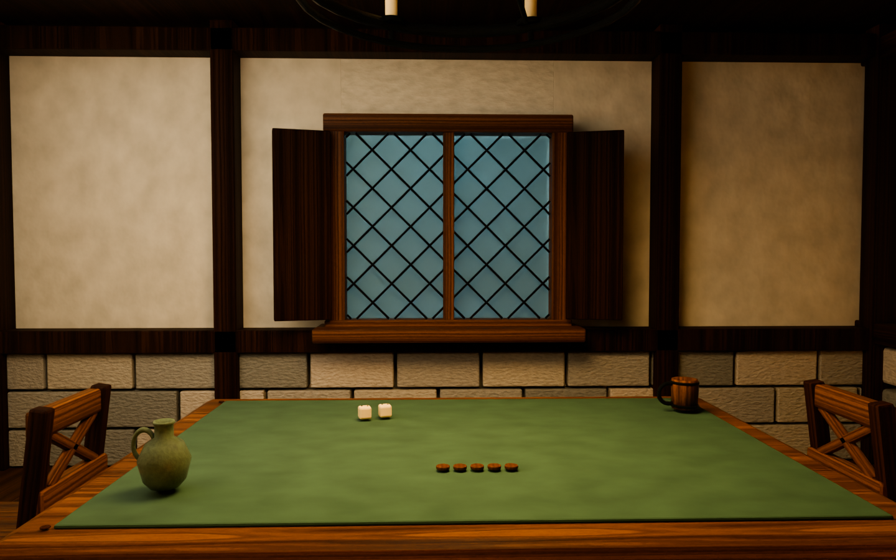
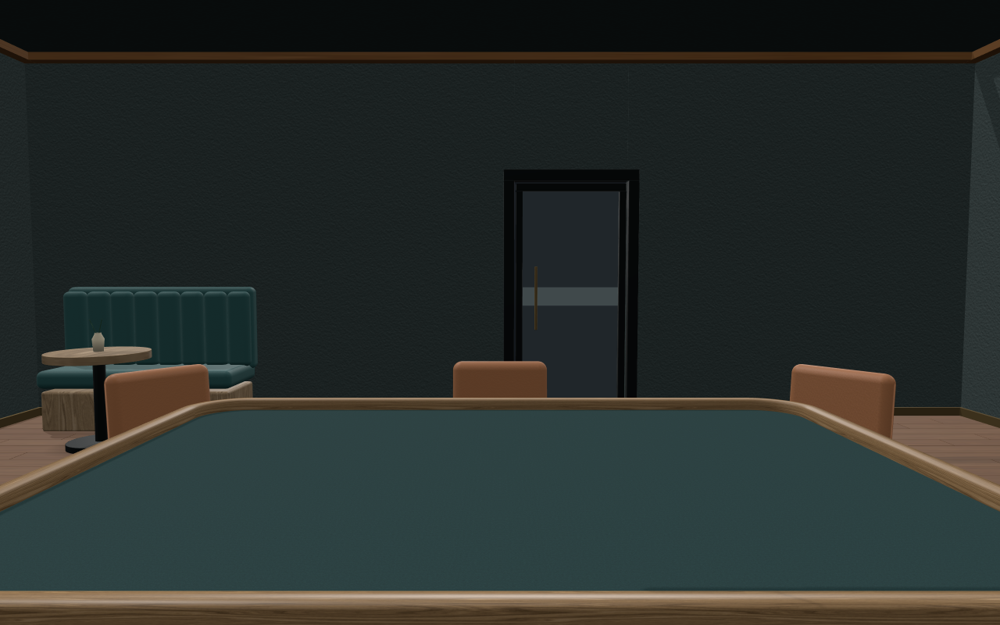
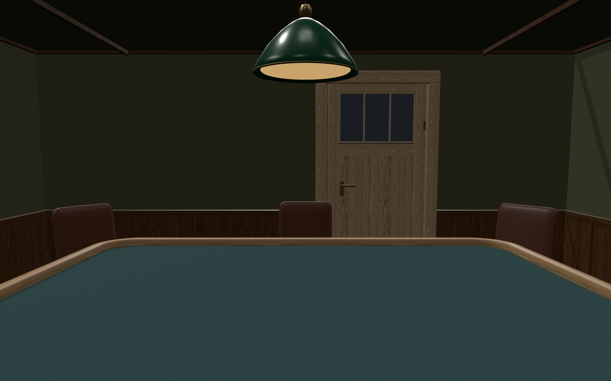
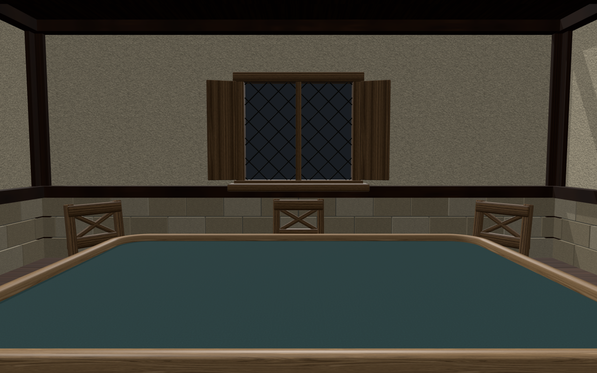

# Room theme expansion

Written 2026-10-16 (America/Phoenix).

Status: the fourteen-theme lineup is accepted. Poker Night is implemented locally
and the user reported the refreshed room looks really good. The user approved the
Medieval Tavern Blender mockup on 2026-10-16 ("Yep looks great"). Eight Tavern GLBs
are published and the theme is registered locally. Automated integration checks
pass, and the user accepted the window/support corrections, confirming the flicker
is gone. The user approved Modern Bar with "Looks good"; it is now integrated
locally, with verification recorded below. The user accepted its chair/pendant
corrections on 2026-10-17. Rear-wall additions for these three themes are now
approved with "Looks great" and integrated locally; verification is recorded
below. Other themes
remain a backlog.
Historical check results remain
labeled by slice; they do not establish later model/device or multiplayer QA.

[Approved Poker Night concept](mockups/poker-night-concept.png) ·
[Image-generation prompt](mockups/poker-night-concept.prompt.txt).
The concept was generated with the built-in imagegen tool and is a design
reference, not runtime artwork.

## Theme lineup

Each room should feel like a place where people gathered to play. Keep the table
as the centerpiece, the playing surface calm, decorative clutter around the room
edges and the strongest useful illumination on the table.

| Theme | Table and surroundings | Lighting and mood |
| --- | --- | --- |
| Poker Night | Green felt, dark wood, leather chairs and drinks on side tables. A padded rail is a possible later table-style extension. | Low pendant fixtures; intimate private card room. |
| Medieval Tavern | Heavy oak table, mismatched stools, timber beams, stone walls, barrels and a hearth. | Firelight and candles; rainy windows. |
| Modern Pub / Tavern | Worn wood table, upholstered booths, brick walls, bar counter and bottle shelves. | Amber lamps, subtle neon and an evening city outside; social and comfortable. |
| Starship Lounge | Rounded metal table with an inset playing surface, built-in seating, wall panels and a viewport. | Soft strip lighting, stars and a planet beyond the glass; serene spaceship interior. |
| Victorian Study | Polished walnut table, bookshelves, fireplace, globe and tall curtains. | Warm, quiet and slightly mysterious. |
| Mountain Cabin | Sturdy pine table, exposed rafters, wool rugs and snowy windows. | Relaxed board-game weekend. |
| 1920s Speakeasy | Intimate card table, burgundy velvet, brass details and patterned wallpaper. | Glamorous and secluded. |
| Pirate Captain's Cabin | Weathered table, stern windows, hanging lanterns, maps and sea chests. | Warm lanterns against the sea outside. |
| Wizard's Workshop | Carved table, potion shelves, curious instruments and a few gently floating objects. | Magical study; animation is optional later polish. |
| Cyberpunk Back Room | Battered table in an apartment or arcade back room, rain-streaked windows. | Colored city light and an after-hours mood. |
| Japanese Game Café | Light wood, comfortable seating, shelves of games, plants and broad windows. | Bright and welcoming. |
| Garden Conservatory | Simple table under a glass roof, surrounded by greenery. | Soft daylight and rain outside. |
| Ancient Temple | Stone playing table, monumental columns, braziers and an open landscape view. | Dramatic scale with a readable playing surface. |
| Orbital Observation Deck | Circular table, minimal furnishings and an enormous planetary view. | Quiet, expansive and more open than the Starship Lounge. |

Delivery starts with Poker Night. The other three initial requests—Medieval Tavern,
Modern Pub / Tavern and Starship Lounge—are the proposed next sequence. Remaining
themes are the accepted backlog, with order and concrete designs still open.
Room descriptions express art direction; proposed different table models,
special lighting, weather, sound and animation are not existing capabilities or
automatic additions to the first slice.

## Existing implementation and reuse decision

The starting choices before this slice were Standard and Cozy. Poker Night now
uses the existing
[room-theme component contract](ROOM_THEMES.md), rather than a separate room
renderer or a fork of Cozy's lifecycle:

- `public/rendering/rooms/room-themes.js` resolves bundled definitions;
  `room-backdrop.js` follows the shared room selection.
- `room-environment.js` orchestrates structure, openings, play area, furnishings,
  decoration and atmosphere. It owns rebuilds, cutaways and cleanup.
- `room-assembly.js` and `room-seating.js` already own model replacement, batching,
  device policy and occupied seating. Reuse those responsibilities.
- `shared/room-environments.js` owns the public IDs/options. The server persists
  the selection in `rooms.room_environment`, introduced by migration 024 and
  extended by migration 025 for this slice.
- The existing **Room style** select and **Use matching table** action provide
  the entry points. Matching metadata currently supports wood and felt only;
  shape, dimensions, lighting and sky remain independent.

Add a focused Poker Night theme definition and art-specific builders/materials.
Extend an existing surface helper only where geometry/material rules actually
match. Do not copy phone preparation, seating, cutaway, disposal or save logic.
Padded rails, built-in seats and alternative tabletop materials would require
separate table-owner work; they must not be disguised as nonphysical scenery on
the playing surface.

Evidence: Tier 2 graph discovery, exact runtime/settings snippets and direct source
checks against graph generation `2026-10-16T16:13:36Z`. Coverage reported no recorded
gaps in the registry/runtime/settings files. The HTML/schema reported partial
coverage; the relevant settings markup and database definition were read directly.
Rediscover current callers and check freshness before implementation.

## Poker Night: approved first visual proposal

Registered ID: `poker-night`. Display name: **Poker Night**.

### Room and table

- An intimate private card room with dark walnut wainscoting, muted olive upper
  walls, warm wood floor and a restrained charcoal rug.
- Dark brown leather chairs at occupied seats, aligned through the existing
  seating owner. The concept's chairs illustrate appearance, not a fixed roster.
- Brass and green-shaded pendant above the table, with sufficient seated camera
  clearance. Use material appearance first; theme selection must not override
  room lighting or introduce extra shadow-light passes.
- A small wall-side sideboard with a few glasses and a carafe, plus a curtained
  window. Window views continue to use the existing chosen sky; the night scene
  in the concept is illustrative, not an automatic skybox change.
- Wall/ceiling-attached fixtures follow their support's cutaway. Overhead views
  reveal the full table without pendant or ceiling obstruction. Preserve a clear
  seated view and usable chair/camera clearance across supported sizes/shapes.
- **Use matching table** proposes existing Walnut wood and green felt `#1e5c3f`.
  Selecting the room alone retains the current table finish. No fixed oval shape,
  padded rail, cup holders, poker betting marks or decorative gameplay pieces in
  the first slice. Existing table shape and dimensions remain authoritative.
- No theme-specific poker rules, betting automation, scoring or deck changes.

The generated concept is a visual target for review, not an in-app screenshot or
proof of final lighting/performance. Implementation must work with independent
saved lighting, table choices and sky, including brighter presets.

### Approved settings examples

Use the current native select and text button. Add the Poker Night option; retain
the existing visible labels in full and compact modes. No new/replaced icon is
proposed. Tabler icon selection is therefore not needed for this slice.

Desktop, both full and compact:

```text
Room style   [ Poker Night                         v ]
             Shared with everyone. Saved for this room.

Room match   Poker Night   [ Use matching table ]
             Applies Walnut wood and dark green felt. Keeps shape and size.
```

Touch / narrow layout, both full and compact:

```text
Room style
[ Poker Night                                  v ]
Shared with everyone. Saved for this room.

Room match
Poker Night
[ Use matching table ]
Applies Walnut wood and dark green felt.
Keeps shape and size.
```

Preserve semantic controls, accessible descriptions, native keyboard operation,
visible focus, GM/owner permission states and 44px touch targets. Mouse, keyboard
and touch keep the current room selection/matching actions and camera intents;
no new tabletop gesture is proposed.

## Implementation slices

1. **Scenery and lifecycle.** Build Poker Night through the existing component
   contract, with procedural failure fallbacks and room-owned materials. Use the
   current cutaway and occupied-seating owners. Review seated and overhead views,
   dimension/shape adaptation and desktop/phone rendering. Preserve original
   authored files in the companion asset workspace; record provenance/licenses
   for bundled assets and use the established GLB publishing workflow.
2. **Selection and persistence.** Register `poker-night` in the browser registry
   and shared options. Add the next unused numbered migration extending the
   environment constraint; update the fresh-install baseline/migration ledger.
   Keep Standard as the default and reuse the guarded roomEnvironment/save path.
   Refresh in-app help to describe the available choice. Keep table matching
   explicit through the existing wood/felt messages.
3. **Verification and documentation.** Add meaningful theme/lifecycle/persistence
   regressions; verify the production bootstrap and registered path. Update
   [REFERENCE.md](REFERENCE.md), [ARCHITECTURE.md](ARCHITECTURE.md),
   [ROOM_THEMES.md](ROOM_THEMES.md), asset credits and [CHANGELOG.md](../CHANGELOG.md)
   with actual implementation and upgrade requirements. Leave a cohesive version
   ready for user testing before starting another theme.

## Verification and acceptance

For the current documentation/design slice: check local links, consistency and
`git diff --check`. Runtime suites are not evidence for an unimplemented theme.

After implementation, run `npm run check`, `npm run test:components`,
`npm run test:devices` and `npm run test:integration` for the settings and migration
work. Run `test:models` for new bundled GLBs; run `test:input` if input handling
changes. Verify stale/failed asset loads, repeated switches, palette disposal,
occupied-seat changes, small/large tables and all supported shapes. Use phone
compatibility materials and bounded textures; retain readable felt and pieces.

Manual smoke test after the implementation's migration/server restart and client
refresh:

- A GM/owner selects Poker Night; another client sees it, while unauthorized
  users cannot change it. Refresh, reconnect and restart preserve the selection.
- Switching Standard → Poker Night → Cozy → Standard leaves no stale scenery.
- Room selection preserves the current table. Explicit matching changes only wood
  and felt. Scene load, game reset and saved-game load preserve the room choice.
- Seated, panned, outside-wall and overhead views show appropriate cutaways;
  pendants, chairs and wall dressing do not obstruct gameplay or picking.
- Full/compact desktop and touch settings remain readable, focusable and usable.
  Test an actual phone for cold load, GPU performance and orbit feel.

## Progress

- [x] Record all fourteen theme concepts and the shared art principles.
- [x] Inspect the existing registry, runtime, settings and persistence boundary.
- [x] Prepare Poker Night art direction and desktop/touch settings examples.
- [x] Obtain explicit approval of the concrete Poker Night proposal, as required
  by [AGENTS.md](../AGENTS.md).
- [x] Implement Poker Night scenery, registration and durable selection.
- [x] Complete applicable automated verification and document results.
- [ ] Complete user/manual testing; do not infer it from automated checks.

No push or deployment is authorized by this plan.

## First implementation and file summary

The first pass uses original procedural scenery and existing credited textures
and rubber-plant GLB. The approved concept is the visual direction; it does not
claim photorealistic asset parity. No authored source or existing GLB was replaced.
The room uses saved lighting/sky and supports every existing table shape.

Inspected runtime previews, using the real table renderer and saved neutral
lighting: [seated](mockups/poker-night-runtime-seated.png) and
[overhead](mockups/poker-night-runtime-overhead.png). These are separate from the
generated concept. The local browser render reported no errors or missing assets;
it is not a substitute for manual multiplayer/device testing.

| File | Changes and functions |
| --- | --- |
| `public/rendering/rooms/poker-night-theme.js` | Adds `POKER_NIGHT`/`POKER_NIGHT_THEME`, `createMaterials`, `buildStructure`, `buildOpenings`, `buildPlayArea`, `buildFurnishings` and `buildDecoration`. Reuses existing surface geometry, assembly, seating and lifecycle. |
| `public/rendering/rooms/room-themes.js` | Registers Poker Night; existing `getRoomTheme` resolves it without a separate path. |
| `shared/room-environments.js` | Adds the whitelisted ID/name; existing validation and normalization now accept it. |
| `postgres/025_poker_night.sql`, `postgres/schema.sql` | Extend the constraint through a new migration and the fresh-install baseline/ledger; retain existing selections and Standard default. |
| `public/table.html` | Updates existing in-app room-style help; existing select/button layout and icons remain. |
| `test/poker-night.js` | Adds production-backdrop fixtures and regressions for settings independence, occupied seats, switching/disposal, cutaways, shape/size budgets and phone policy. |
| `test/room-backdrop.js`, `test/room-settings.js` | Extend option coverage and verify explicit Walnut/green matching through existing messages. |
| `test/backend-room-state-handlers.js`, `test/backend-schema.js` | Extend permission/repeat-save and synchronized patch/late-join coverage to Poker Night. |
| `scripts/test-database.mjs`, `test/integration/database.js` | Extend migration preservation/idempotence/constraint checks and actual saved-state/fresh-connection integration coverage. |
| `scripts/component-parity.mjs` | Adds a Poker Night production bootstrap scenario and exercises approved full/compact desktop/touch settings; updates three-option expectations. |
| `docs/ROOM_THEMES.md`, `docs/REFERENCE.md`, `docs/ARCHITECTURE.md` | Document the registered theme, unchanged ownership boundaries and upgrade requirements. |
| `docs/ASSET_CREDITS.md`, `CHANGELOG.md` | Record original/reused art provenance and the implemented slice. |
| `docs/PLAN_ROOM_THEMES.md`, `docs/mockups/poker-night-concept.png`, `docs/mockups/poker-night-concept.prompt.txt`, `docs/mockups/poker-night-runtime-{seated,overhead}.png` | Preserve the theme backlog, approved concept/prompt, inspected runtime previews, implementation decisions and test status. |

No existing production function is removed. The existing settings/server save
handlers need no new helper or behavior branch. Apply migration 025 through the
configured migration role, restart the server, then refresh clients to try the
new room style. A deployment or production database migration has not been run.

## Verification results — 2026-10-16

| Check | Actual result |
| --- | --- |
| `npm run check` | Passed: lint, formatting, CSS checks and 1,182 tests. |
| `npm run test:components` | Passed: full component scenarios on desktop and coarse-touch 390px, including the real Poker Night bootstrap and full/compact settings; notecard and tile-preview checks also passed. The harness logged only an unrelated favicon 404. |
| `npm run test:devices` | Passed all seven documented desktop/laptop/narrow/tablet/phone profiles. |
| `npm run test:integration` | Passed all 25 PostgreSQL integration tests; migration 025 was also exercised against existing Standard/Cozy rows, repeated application and unknown-ID rejection. |
| Render inspection | Inspected seated and overhead views with the real table renderer, current neutral lighting and plant GLB; browser reported no exceptions or missing assets. |
| Documentation | Local Markdown link/consistency checks and `git diff --check` passed. |

Browser/database suites required localhost/Docker access and passed after running
outside the restricted sandbox. No remaining automated blocker is recorded.
No new input path or bundled model payload was added, so `test:input` and
`test:models` were not required/run for this slice. Existing GLBs were loaded
through the production loader during browser checks and render inspection.

Manual multiplayer gameplay, actual-phone cold load/GPU performance, gesture feel,
and user acceptance remain pending. Use the smoke-test list above after migration
025, a server restart and client refresh. No push or deployment was performed.

## Blender asset redesign review

On 2026-10-16 the user reported wooden supports clipping through the chair back,
flat upholstery and a floor that was too light. After a separate Three.js preview,
the user explicitly requested redesigning the assets in Blender and showing a
mock-up. The new work was authored through the live BlenderMCP connection and
saved as companion `poker_night_v1/poker-night-assets.blend`, preserving the
previously open startup scene and all existing authored sources.

New masters: shaped leather chair with welts/seams and grounded tapered legs;
inset-door walnut sideboard; hollow green pendant; crystal carafe and tumbler;
curtained casement; framed original landscape; woven rug; dark walnut floor sample.
UV-based leather color, normal and roughness maps are original 512px images.
Existing credited walnut color and original rubber-plant GLB are reused. The
table is a scale stand-in and room lights are review lighting, not proposed
runtime overrides. This slice adds no app code, bundled GLB, icon or input path.

The companion [source notes](../../Open-Tabletop_Asset_Builders/3d_models/original/poker_night_v1/README.md)
record every source/helper, image, scene, report and verification boundary.
Review renders:
[chairs](../../Open-Tabletop_Asset_Builders/3d_models/original/poker_night_v1/poker-night-chair-review.png),
[room](../../Open-Tabletop_Asset_Builders/3d_models/original/poker_night_v1/poker-night-room-review.png),
[furnishings](../../Open-Tabletop_Asset_Builders/3d_models/original/poker_night_v1/poker-night-furnishings-review.png).
All are actual 64-sample Cycles renders from the saved/reopened source.

Geometry checks pass for nine masters: textured UVs, packed images, own maps at
most 512px and exposed chair wood ending at 0.4245m, below the back cushion.
The chair has 15,712 review triangles including modifiers; export optimization
and material batching remain open. The missing-file inspector reports none.
Front/rear chair, room/darker floor and cabinet/pendant renders were visually
inspected. No full app suite was rerun for this source/mock-up/documentation slice.

- [x] Author editable Blender models/materials and preserve original sources.
- [x] Render/inspect the actual Blender mock-ups and record source checks.
- [x] Obtain approval of this Blender redesign before replacing runtime visuals.
- [x] Publish optimized GLBs/maps through the existing verified asset pipeline.
- [ ] Integrate with shared seating, cutaways, device policy and resource ownership.
- [ ] Run the applicable app/model/component/device checks and manual gameplay QA.

The earlier automated passes above apply to the first procedural runtime only.
The user approved their edited curtains/tiebacks on 2026-10-16. The approved
snapshot is `poker-night-assets-approved.blend` (SHA-256
`62d76ab2db5e4dbc07eb58d63293bc7b1716ec44e7734ea3f723e70a0c62e585`).
The window export uses the edited room instances, preserving those edits; the
other seven exports use the authored masters. The publisher validated each
optimized GLB on desktop and touch. Runtime integration is not yet fully verified
or deployed.

At 11:02 AM local time, systemd-oomd killed a 388-process scope containing Codex
after RAM and swap exceeded 90% usage. Blender saved the source at 11:03 AM;
the approved snapshot hash remains unchanged. An outdated curtain-parent test
was then found to stall while formatting a scene-graph equality failure.
Checking identity as a boolean and correcting the expected fallback ancestry
restored all three focused tests (78 ms, with a 192 MiB JavaScript heap limit).
The constrained `npm run check` then passed lint, formatting, CSS checks and all
1,190 tests in 94 seconds for the test stage. RAM remained stable afterward
(20 GiB available). This validates the current code, not the remaining model
integration browser/render checks. The kill record does not isolate the
individual process responsible. Remaining checks must run with bounded
memory/concurrency; no new render work was started during this investigation.

Recovery file summary: `test/poker-night.js` updates curtain ancestry and uses
boolean scene-identity assertions; no functions/helpers are added or removed.
`CHANGELOG.md` and this plan record the fix, preserved sources and verification
limits. `git diff --check` passes. No push or deployment was performed.

File summary for this review slice: the companion `poker_night_v1/` directory adds
`build_poker_night.py`, `validate_poker_night.py`, `README.md`, the packed `.blend`
and its automatic backup, nine texture images, three early draft images, three
final review images and build/geometry/render JSON reports. New builder helpers
are enumerated in its README; the validator adds inspection assertions only.
App-side edits are documentation only: this plan, `ART_DIRECTION.md`,
`REFERENCE.md`, `ARCHITECTURE.md`, `ASSET_CREDITS.md` and `CHANGELOG.md` record
the review/source/provenance boundary. No production function or shipped asset
is changed by this Blender redesign slice.

## Medieval Tavern Blender mockup

Requested 2026-10-16: "Lets start on the medieval tavern next. Use Blender again
and show me a mockup." The requested review is now authored in BlenderMCP and
saved in companion `3d_models/original/medieval_tavern_v1/`. The review source
preserves the previously open `Scene` and its two objects; Poker/Cozy files and
the app runtime are untouched by this slice.

Design: a warm inn with oak framing and wide boards, limewash over rough limestone,
a true arched hearth recess, diamond-leaded casement, heavy pegged trestle table,
cross-back chairs, three-legged stools and bench, coopered barrels, paneled bar,
stoneware and tankards, faded cup pennant and forged candle wheel. A muted moss
playing cloth keeps the center calm. The game props, table and warm/cool review
lights illustrate the composition; they are not proposed automatic gameplay,
physics or saved-lighting changes.

Actual Cycles renders from the saved/reopened source:

- [Room mockup](../../Open-Tabletop_Asset_Builders/3d_models/original/medieval_tavern_v1/medieval-tavern-room-review.png)
- [Seated camera](../../Open-Tabletop_Asset_Builders/3d_models/original/medieval_tavern_v1/medieval-tavern-seated-review.png)
- [Editable source](../../Open-Tabletop_Asset_Builders/3d_models/original/medieval_tavern_v1/medieval-tavern-mockup.blend)
- [Source notes and verification](../../Open-Tabletop_Asset_Builders/3d_models/original/medieval_tavern_v1/README.md)

The source uses the existing builders' focused primitive/UV/packed-material
patterns in a separate authoring script, preserving approved sources rather than
importing scripts that build scenes at module scope. New geometry and procedural
stone/plaster/cloth are original project work; the existing credited CC0 oak
color and original Cozy normal derivative are reused and packed. No downloaded
model, photo, font or generated-image insert is used.

First-render corrections fixed bar-vessel parenting, rear-chair orientation,
hearth recess/flames, ceiling infill and camera framing. Both final images use
48-sample denoised CPU Cycles, four threads, rendered sequentially at 1440×1000
and 1440×900. Source checks cover preserved original scene, evaluated geometry,
UV layers, packed file images and absence of linked review object/data. Full-room
triangle counts include all construction/dressing and are not a runtime budget.
Actual reports and intermediate drafts are retained beside the source. Images
are visually reviewed; manual user acceptance is still pending.

- [x] Create editable Blender mockup and actual room/seated renders.
- [x] Validate saved source and inspect the render composition.
- [x] Review the design with the user before runtime integration.
- [x] Bake/adapt procedural shaders, optimize per-asset GLBs and publish through
  the verified asset pipeline.
- [x] Reuse registered room lifecycle, size adaptation, cutaways and occupied
  seating; preserve shared-state, table and lighting ownership.
- [ ] Run the applicable model/app/device checks and manual gameplay review.

No new runtime ID, database migration, app control/icon, input handler, physics or
light is introduced. App runtime suites are not rerun for this review-only asset
and documentation slice. Documentation paths, Python syntax and diff whitespace
are checked. No push or deployment is performed.

Files added in companion `medieval_tavern_v1/`: packed `.blend` and automatic
backup, `build_medieval_tavern.py`, `refine_medieval_tavern.py`,
`finish_medieval_tavern.py`, `render_validate_medieval_tavern.py`, `README.md`,
build/review reports, two final images and intermediate drafts. Builder helpers
are enumerated in the README; refinements and validator add no callable helpers.
App-side documentation touched: this plan, `ART_DIRECTION.md`, `ASSET_CREDITS.md`,
`REFERENCE.md`, `ARCHITECTURE.md` and `CHANGELOG.md`. No production function is
added, changed or removed.

### Medieval Tavern integration — 2026-10-16

Approved snapshot SHA-256:
`97fdbeb50f042d17547e71883771258ee6471ededb5c3ab5421191e13e82bb91`.
Eight material-batched GLBs total 10,103,652 bytes; every derivative passed source/
candidate material, hierarchy, image-pixel and GPU checks on desktop and coarse
touch through the canonical publisher. Original periodic 512px PBR maps adapt the
review's procedural relief; the approved source is unchanged. Source emission
remains static, glass becomes nearly clear alpha, and no lights/table are imported.

`medieval-tavern-theme.js` adds `MEDIEVAL_TAVERN`, `MEDIEVAL_TAVERN_THEME`,
`createMaterials`, `buildStructure`, `addFurnishing`, `buildOpenings`, `buildPlayArea`
and `buildFurnishings`. Existing assembly, surfaces, occupied seating and lifecycle
owners are reused without new branches in those owners. Oak/moss matching stays
explicit; per-wall furnishing groups follow their support cutaways. Shape/size,
occupancy, model failure, mobile policy, disposal and stale-load regressions live
in `test/medieval-tavern.js`. No existing production helper is removed.

Additive migration 026 extends the environment whitelist, preserving existing
room selections/defaults. Shared options, registry, help text, native select
fixtures, permission/schema tests and disposable-database checks extend the existing
contracts. Production bootstrap gets a Medieval Tavern scenario with real GLBs,
matching messages, glazing, overhead cutaway, switching and lighting independence.

Real renderer captures (neutral saved lighting):
[seated](mockups/medieval-tavern-runtime-seated.png),
[overhead](mockups/medieval-tavern-runtime-overview.png). Both were visually inspected;
this capture reported no browser errors or missing assets. The first four focused
Tavern tests pass under a 192 MiB heap; the full `npm run check` passes lint,
formatting, CSS checks and 1,203 tests with one worker / 512 MiB per process.
Full model checks pass all 118 GLBs on desktop/coarse touch; the new bootstrap
scenario passes both profiles. Migration 026 preservation/reapplication checks
and all 25 disposable PostgreSQL integration tests pass. Full desktop/coarse-touch component checks (including notecard and tile-preview
companions) and all seven device profiles pass. The final real-model clearance
regression passes both profiles after the layout change. Actual-phone
performance, multiplayer gameplay and user in-app acceptance remain pending.

Integration file summary: the new theme/test/migration and eight GLBs plus their
README; four `textures/tavern-*` shell maps; updated `room-themes.js`,
`shared/room-environments.js`, schema baseline, generated model allowlist/manifest
and table help; settings/backdrop/permission/schema/database tests and component
fixtures; two runtime preview images. Documentation updates cover this plan,
room-theme contracts, art direction, asset credits, reference, architecture,
model-root README and changelog. Companion additions are the approved snapshot,
`export_runtime.py`, raw runtime GLBs/PBR maps and export report. No migration of
an existing user database, server restart, push or deployment was performed.

| File/group | Final change |
| --- | --- |
| `public/rendering/rooms/medieval-tavern-theme.js` | Adds the theme/configuration and six art/material/slot builders named above; no separate lifecycle or mutable global renderer. |
| `public/rendering/rooms/room-themes.js` | Adds its import/registry entry; existing `getRoomTheme` resolves it. |
| `shared/room-environments.js` | Adds the option; existing validator/normalizer recognize it. |
| `postgres/026_medieval_tavern.sql`, `postgres/schema.sql` | New additive whitelist migration and fresh baseline/ledger. |
| `public/table.html` | Extends existing room-style help; no new controls/icons or gesture path. |
| `public/static_assets/models/environments/medieval-tavern/*` | Eight approved, validated model derivatives and provenance/placement README. |
| `public/static_assets/models/manifest.json`, `public/rendering/builtin-model-assets.js` | Publisher-generated integrity records and URL registrations. |
| `public/static_assets/textures/tavern-{stone,plaster}-{color,normal}.png` | Four original shell map adaptations. |
| `test/medieval-tavern.js` | Adds `state`/`fixture` and four lifecycle, occupancy/size, cutaway, mobile, fallback and late-load regressions. |
| `test/room-backdrop.js`, `test/room-settings.js` | Extends public choices and explicit Oak/moss matching assertions using existing fixtures. |
| `test/backend-room-state-handlers.js`, `test/backend-schema.js` | Extends guarded saves and patch/late-join cases; no server behavior helper is added. |
| `scripts/test-database.mjs`, `test/integration/database.js` | Checks migration preservation/reapplication, schema ledger and durable fresh-connection room choice. |
| `scripts/component-parity.mjs` | Adds the production bootstrap scenario and real-model clearance regression; updates native select expectations. |
| `docs/mockups/medieval-tavern-runtime-{seated,overview}.png` | Captures the integrated room through production modules. |
| `CHANGELOG.md`, `docs/ROOM_THEMES.md`, `docs/REFERENCE.md`, `docs/ARCHITECTURE.md`, `docs/ART_DIRECTION.md`, `docs/ASSET_CREDITS.md`, `public/static_assets/models/README.md`, this plan | Records behavior, boundaries, provenance, totals, operating steps and verification limits. |
| Companion `medieval_tavern_v1/README.md`, `medieval-tavern-approved.blend`, `export_runtime.py`, `runtime/*` | Approval/provenance, preserved snapshot, `png`/`portable` export helpers, raw GLBs/maps and source/matrix/hash report. |

A final layout review moved decorative stools to the east wall and increased
room clearance to sixteen units, avoiding occupied-chair crowding near the bar
on small or large tables. Production browser regression now measures the actual
loaded hearth/bar/barrel/bench/stool bounds against the protected player-seating
area at small rectangular, normal rounded and large round table sizes. Earlier
full component results are supplemented by the final focused resize regression.

### Final automated verification

- `npm run check`: lint, formatting, CSS checks and 1,203 tests pass after the
  layout correction, with one test worker and 512 MiB per Node process.
- `npm run test:models`: all 118 canonical GLBs pass integrity/material/GPU checks
  on desktop and coarse touch under strict CSP.
- `npm run test:components`: full desktop/touch suite, notecard editor and tile
  preview companions pass. The harness logs only the existing favicon 404.
- Final `COMPONENT_SCENE=client-bootstrap-medieval-tavern node scripts/component-parity.mjs`:
  desktop/touch pass, including actual model bounds at three table size/shape cases.
- `npm run test:integration`: all 25 disposable PostgreSQL tests and migration
  026 preservation/reapplication/unknown-ID checks pass.
- `npm run test:devices`: all seven documented profiles pass.
- Approved/editable Blender hashes remain unchanged; Python sources parse and
  new plan links resolve. `git diff --check` passes.

To try locally, apply migration 026 via the configured migration role during the
normal server upgrade/restart, refresh clients, then select **Medieval Tavern**.
Smoke-test style switching, small/large/round tables, joining/leaving seats,
seated/exterior/overhead camera views and explicit Oak/moss matching. The
existing table and saved lighting/sky must stay independent. Actual-device GPU
performance, gesture feel and multiplayer acceptance are not established by these
automated checks. No real user database was migrated and no server was restarted
by this implementation; no push or deployment was performed.

### Medieval Tavern window and table fit correction — 2026-10-16

The in-app review found embedded shutters, flickering exterior window casing and
a floating tabletop. The window-wall rear face was almost coplanar with the
authored casing, and the Tavern play-area builder omitted its table supports.
The corrected window stands the two shutter leaves 0.20 m farther into the room;
the thinner west plaster wall keeps its interior face fixed and clears the
exterior casing. Timber-post spacing now protects the full shutter surround,
including the owner's wider right-shutter position.

The open Blender scene contained unsaved owner edits. Those were captured as
`medieval-tavern-window-fit-input.blend`, and the correction was made in a separate
`medieval-tavern-window-fit.blend`. The live scene remains open and unsaved, and the
approved snapshot is unchanged. The corrected source SHA-256 is
`3535a95fb390fc491cde23204efff09b8eb7013d03ea69e10f0a8de9762288c3`.
Only the window GLB was republished; the other seven models and authored materials
were preserved. The eight Tavern derivatives now total 10,103,664 bytes.

The existing play-area builder now creates two oak trestles with diagonal braces,
feet, top bearers and a cross stretcher. It reuses the shared table outline and
`TABLE_FINISH.rimBase` so supports fit each shape and meet the actual underside.
The width-sized hex outline also remains correct when saved width/depth differ.
Existing assembly ownership handles shadows, cutaways and disposal. No new
production function or helper was added or removed; these corrections add no
physics collider, input path, control, icon or server state.

Current renderer captures: [window clearance](mockups/medieval-tavern-window-fit.png),
[trestle base](mockups/medieval-tavern-table-base.png),
[seated](mockups/medieval-tavern-runtime-seated.png) and
[overview](mockups/medieval-tavern-runtime-overview.png). The base close-up clears
occupied chairs for inspection. Browser captures reported no errors or missing
assets. Images were visually inspected; user acceptance and an interactive
exterior camera orbit remain pending.

| Files changed in this correction | Changes/functions |
| --- | --- |
| `public/rendering/rooms/medieval-tavern-theme.js` | Extends `MEDIEVAL_TAVERN`, `buildStructure` and `buildPlayArea` for physical wall clearance and adaptive decorative supports. |
| `test/medieval-tavern.js` | Adds a support bounds/disposal regression across five outlines, five aspect/size cases and desktop/phone policies; existing `state`/`fixture` are reused. |
| `scripts/component-parity.mjs` | Extends the existing Tavern scenario with exact transformed shutter/casing vertex checks, wall/post intersection checks and real-table underside alignment. No new helper. |
| `public/static_assets/models/environments/medieval-tavern/tavern-window.glb`, `public/static_assets/models/manifest.json` | Corrected window and publisher integrity record; existing model URLs are unchanged. |
| `docs/mockups/medieval-tavern-{window-fit,table-base,runtime-seated,runtime-overview}.png` | Two new inspection views and refreshed room views. |
| `CHANGELOG.md`, `docs/ROOM_THEMES.md`, `docs/REFERENCE.md`, `docs/ARCHITECTURE.md`, `docs/ART_DIRECTION.md`, `docs/ASSET_CREDITS.md`, both model READMEs, this plan | Records fit/reuse decisions, provenance, current byte totals and verification. |
| Companion `medieval_tavern_v1/fit_window.py`, two `medieval-tavern-window-fit*.blend` snapshots, `window-fit-report.json`, `window-fit-export-report.json`, `runtime/tavern-window.glb` | A one-time guarded source correction, preserved input, corrected source, source/export reports and raw window derivative. |
| Companion `medieval_tavern_v1/export_runtime.py`, `README.md` | Adds explicit source/subset/report overrides and a guard against overwriting the corrected window from the old approval source; documents reproduction. Existing `png`/`portable` helpers are unchanged. |

Verification after the correction:

- `npm run check`: lint, formatting, CSS and all 1,204 tests pass with bounded
  concurrency/heap. The five focused Tavern tests also pass independently.
- `COMPONENT_SCENE=client-bootstrap-medieval-tavern npm run test:components`:
  the Tavern desktop/coarse-touch scenario and notecard/tile companions pass,
  including loaded-window clearance and table-base alignment.
- `npm run test:models`: all 118 canonical models pass desktop/coarse-touch
  integrity, material and GPU checks under strict CSP. The window publisher also
  passes its source/candidate comparison on both profiles.
- No database, gesture or responsive layout behavior changed in this correction;
  integration/device suites above describe the preceding integration run.

For an already installed Medieval Tavern, hard-refresh the client. These asset
and rendering corrections require no additional migration or server restart.
Smoke-test the window from both sides while orbiting and inspect the base at
small/large and round/hex table sizes. Real-device performance and multiplayer
acceptance remain manual checks. No push or deployment was performed.

### Second window fit review — 2026-10-16

The owner accepted the table legs and left shutter, requested the right shutter
beside the frame, and reported continuing flicker. The previous depth-only test
missed coplanar side reveals: the plaster hole's half-width was 5.32, exactly
matching the wooden jamb's inner face. The top/bottom plaster also ended just
inside the glazed opening. The wall cutout now measures 11.76 by 10.5 units,
starting 7.35 above the floor. Its edges terminate within the solid timber on all
four sides, leaving about 0.56 units behind the inner jamb faces and 0.455 behind
the inner lintel faces. The existing fallback builder uses the same opening
dimensions. Existing wall/surface/assembly functions are reused; no production
function or helper is added or removed.

Background Blender creates `medieval-tavern-window-reveal.blend` from the previous
fit source. `refine_window.py` moves only the right shutter's X from 1.6m to
1.05m, mirroring the reviewed left leaf; stand-off/rotations/scales/materials
remain unchanged. The approval file, both earlier fit snapshots and live open
file are preserved. Current source SHA-256:
`3bd3b5181a3a44e0b5fffc2a215c6a1ccd85ab1839b4f33ed3bb451cc42e1c0a`.
Existing source/subset/report overrides export only the window, with audit reports
`window-reveal-report.json` and `runtime/window-reveal-export-report.json`.
The canonical window is 800,924 bytes, and the eight Tavern models total
10,103,652 bytes. The remaining seven models are unchanged.

This correction touches `MEDIEVAL_TAVERN` opening dimensions and a framing comment
in `public/rendering/rooms/medieval-tavern-theme.js`; the existing Tavern browser
scenario in `scripts/component-parity.mjs`; the window GLB and generated manifest;
the four refreshed runtime/fit preview PNGs and two additional front/reverse
window PNGs; this plan, changelog, room-theme/art/asset/reference/architecture
documentation and both model READMEs. Companion additions are `refine_window.py`,
the new source snapshot and its two audit reports, with an updated raw window
GLB and companion README. No new UI control/icon, input path, state, migration,
physics collider or gameplay behavior is introduced.

The new real-model regression casts rays toward each inner reveal at three
depths, requiring plaster to sit at least 0.25 units behind timber. It invokes the
Three.js mesh implementation directly because scenery deliberately disables
normal picking. A separate vertex-bounds assertion checks that the right and
left shutter centers mirror each other. The reveal regression reproduced the
old error on both desktop and coarse-touch profiles before the correction.
Existing casing, shutter/wall, table-base and room-layout checks remain active.

Updated captures: [window](mockups/medieval-tavern-window-fit.png),
[front](mockups/medieval-tavern-window-front.png),
[opposite angle](mockups/medieval-tavern-window-reverse.png).
The reveal/shutter scenario passes desktop and coarse touch, with notecard/tile
companions passing at their supported widths. All 118 models pass desktop/touch
integrity/material/GPU checks; the window publisher also passes source/candidate
comparison. Front, oblique and opposite-angle captures were visually inspected,
with no browser errors or missing assets. The owner has accepted the table legs; the revised window still needs in-app acceptance after
a hard refresh. No server restart or additional migration is required.

Final `npm run check` passes lint, formatting, CSS checks and all 1,204 tests with
one CPU and a 512 MiB Node heap. The restricted-sandbox attempt hit Node worker/
local-server failures and was stopped; the normal-host rerun passed. No code
changed after that successful check. Python syntax, preserved source hashes,
current manifest byte totals, local plan links and `git diff --check` also pass.
No push, deployment, migration or server restart was performed.

## Modern Bar Blender mockup

The user confirmed the Tavern window now looks good and flickering is gone, then
requested Modern Bar using Blender and a mockup. That accepts the window/support
corrections; it does not establish broader device/multiplayer QA.

The Modern Pub / Tavern lineup entry is developed here as **Modern Bar**: walnut
slats and smoked wood boards, dark quartz counter, brushed brass details,
backlit bottle shelves, exposed umber brick, tan leather chairs and a channel-tufted
teal booth. A large black-framed window shows a small original 3D evening-city
study. Warm pendants, restrained mint signage, lowball glasses and a compact
draught font give the room a contemporary neighbourhood-bar feel. The calm teal
table center remains the focal point; the review table has explicit steel bases.

Actual Blender Cycles renders:

- [Room review](mockups/modern-bar-room-review.png)
- [Seated review](mockups/modern-bar-seated-review.png)
- [Editable source](../../Open-Tabletop_Asset_Builders/3d_models/original/modern_bar_v1/modern-bar-mockup.blend)
- [Source notes and verification](../../Open-Tabletop_Asset_Builders/3d_models/original/modern_bar_v1/README.md)

The source is created via background BlenderMCP, preserving the live unsaved
Tavern file. The separate builder follows the inspected Tavern primitive/UV/
packed-material patterns instead of importing a module that builds a scene at
module scope. The companion authoring directory has no graph project; its existing
builders were read directly after graph-project discovery. No runtime production
function is added, changed or removed. Game table, fixed six-chair composition,
stage lights and city backdrop illustrate the design; their occupancy/physics,
lighting/sky behavior must be mapped to existing owners only after approval.

First-render polish makes the attached artwork follow its review wall cutaway,
keeps the distant city visible through glazing without leaking outside the room,
removes direct/reflected review-softbox cards from the window, tunes warm/cool
lighting and replaces coffee study props with bar dressing. The final two renders
are serial, denoised, 48-sample CPU Cycles with four threads at 1440×1000 and
1440×900. Reopened-source checks cover UVs on all 999 mesh objects, finite/nonempty
geometry, packed images, unique prototype asset keys, intended chair/stool copies,
absence of linked libraries and source-hash preservation during rendering. The
203,196 evaluated triangles include the entire review architecture/dressing;
that is not a runtime model budget. Both final images were visually inspected;
at mockup delivery user approval/export/integration were pending. The following
integration entry records approval and current status. Final source SHA-256:
`7e40e89696523607164ef723d24f864ab9a917cd674c6aed0cc23cd05791f314`.
Python syntax, current source/report hash, unchanged Tavern approval hash, local
plan links and `git diff --check` pass. The live Tavern filepath/dirty state is
unchanged after all background work.

Files added in companion `modern_bar_v1/`: editable `.blend`/backup,
`build_modern_bar.py`, `refine_modern_bar.py`, `finish_modern_bar.py`,
`render_validate_modern_bar.py`, `README.md`, build/refinement/finish/review JSON
reports, two final PNGs and two intermediate room drafts. Builder helpers are
`linear`, `material`, `own`, `asset`, `uv`, `finish`, `box`, `mesh`, `cylinder`,
`rod`, `lathe`, `curve`, `piping`, `duplicate`, `text`, `area` and `camera`.
The refiner reuses those focused geometry functions without executing builder
top-level mutations; refinements/validator add no callable helpers.
App-side files touched are this plan, `CHANGELOG.md`, `ART_DIRECTION.md`,
`ASSET_CREDITS.md`, `REFERENCE.md`, `ARCHITECTURE.md` and two review PNG copies.

- [x] Author a separate editable Blender mockup and render room/seated views.
- [x] Validate the reopened source and visually inspect both final renders.
- [x] Obtain user approval before runtime visual integration.
- [x] Adapt/optimize/export individual approved assets with the verified pipeline.
- [x] Extend the existing theme registry and shared room contract; retain occupied
  seating, cutaways, fallback cleanup and independent table/lighting/sky ownership.
- [x] Run applicable model/runtime/device checks.
- [ ] Complete manual gameplay and actual-device acceptance of the integrated room.

No room ID, migration, app control/icon, input path, physics, runtime light or
published asset is introduced by this mockup slice. App runtime suites are not
rerun for companion authoring/documents alone; earlier Tavern results do not
validate a future Modern Bar integration. Python syntax, documentation links,
source/render checks and diff whitespace are checked. No push/deployment occurs.

## Modern Bar integration

The user approved the rendered Modern Bar design with "Looks good". The exact
approved source is preserved as `modern-bar-approved.blend`, SHA-256
`7e40e89696523607164ef723d24f864ab9a917cd674c6aed0cc23cd05791f314`.
Background Blender exports eleven individual models; the editable source and its
authored materials are unchanged. Runtime models total 8,269,568 compressed bytes
from 14,306,812 source-export bytes. The entire app now has 129 canonical models,
87,647,372 bytes versus 138,524,780 before compression (36.7% smaller).

Export reuses the existing Tavern/Poker evaluated-mesh/material-batching recipe
with focused Modern Bar anchors and converted text/curve geometry. Portable
periodic normal/roughness maps adapt procedural relief, with finer, weaker leather
grain verified in the real renderer. No source shader is saved over. The source
game table, city, staged lights and fixed chair roster are excluded. Alpha window
glazing follows the saved sky and phone policy; emissive strips remain static.
Each derivative passed the canonical publisher's desktop/coarse-touch decoded
geometry/material/image/hierarchy and source/candidate GPU comparisons.

`modern-bar-theme.js` extends the existing six-component contract through shared
assembly, occupied seating, surfaces, model preparation and lifecycle owners.
New art builders/configuration cover the adaptive walnut floor, bounded instanced
brick and plaster shell, window, furnishings, pendants, fallback chairs and steel
table bases. Window rough-opening edges terminate within the solid frame on all
four sides, with real-model ray regressions at three depths. Steel bases meet the
floor and actual tabletop underside across supported outlines/aspect ratios.
Decorative fixtures remain outside the player seating envelope, including small,
large, round, oval and wide-hex tables.

One small shared-owner extension is required: `createRoomEnvironment.sync` now
derives a width-sized hex's enclosure depth from shared `tableOutline`, preventing
floor/walls from clipping a wide hex when its saved depth is small. Round/other
shape rules, seat layout inputs, server physics and saved dimensions are retained.
This reuses the canonical physical outline rather than adding a theme-only size
calculation or separate room renderer. No production helper is removed.

Additive migration `027_modern_bar.sql` extends the environment constraint. The
fresh baseline/ledger includes it. Disposable upgrade tests preserve all prior
styles, notes, wood and Standard defaults; reapplication retains Modern Bar and
unknown IDs fail. Shared options/registry, permission/schema tests and real
PostgreSQL saves/late readers follow existing contracts. The approved native
Room style select receives Modern Bar; no new control, icon or input path is added.
**Use matching table** explicitly applies Walnut / deep teal `#294b4c`; selecting
the style alone leaves table/lighting/sky state untouched.

Actual runtime captures, inspected after leather-map refinement:
[seated](mockups/modern-bar-runtime-seated.png) and
[overview](mockups/modern-bar-runtime-overview.png). They use neutral saved lighting
and the real production core/backdrop/model-loader modules. Capture logs contain
no browser errors or missing assets. The city in the Blender concept remains
illustrative, while runtime retains the user's chosen sky.

| File/group touched | Implementation summary |
| --- | --- |
| `public/rendering/rooms/modern-bar-theme.js` | Adds `MODERN_BAR`, `MODERN_BAR_THEME`, `createMaterials`, `buildStructure`, `placeModel`, `buildOpenings`, `buildPlayArea`, `buildFurnishings`. Reuses shared assembly/surfaces; adds no lifecycle or state owner. |
| `public/rendering/rooms/room-environment.js` | Extends `sync`'s hex depth calculation using shared `tableOutline`; no new helper. |
| `public/rendering/rooms/room-themes.js`, `shared/room-environments.js` | Registry import/entry and public option; existing resolver/validators recognize it. |
| `postgres/027_modern_bar.sql`, `postgres/schema.sql` | Additive whitelist migration and flattened baseline/ledger. |
| `public/table.html` | Updates existing room-style help; controls/icons/gestures unchanged. |
| `public/static_assets/models/environments/modern-bar/*` | Eleven material-batched GLBs and source/anchor/provenance README. |
| `public/static_assets/models/manifest.json`, `public/rendering/builtin-model-assets.js` | Canonical publisher integrity/baseline records and URL registrations. |
| `test/modern-bar.js` | Adds `state`/`fixture` and six shape/occupancy, cutaway, mobile/resource/stale-load, fallback, support and enclosure regressions. |
| `test/room-settings.js`, `test/room-backdrop.js` | Adds explicit matching/independence coverage and accepted option; uses existing fixtures. |
| `test/backend-room-state-handlers.js`, `test/backend-schema.js` | Extends guarded role acceptance and shared patch/late-join tests. |
| `scripts/test-database.mjs`, `test/integration/database.js` | Extends `prepareDatabase` migration upgrade/default/reapply checks, ledger count and durable Modern Bar state through existing database APIs. |
| `scripts/component-parity.mjs` | Adds Modern Bar production-bootstrap scenario, loaded-model clearance/reveal/base checks, resize/cutaway/matching/switch coverage and five-option accessible select expectation. |
| `docs/mockups/modern-bar-runtime-{seated,overview}.png` | Two actual integrated-renderer captures. |
| `CHANGELOG.md`, this plan, `docs/ROOM_THEMES.md`, `docs/ART_DIRECTION.md`, `docs/ASSET_CREDITS.md`, `docs/REFERENCE.md`, `docs/ARCHITECTURE.md`, model-root README | Records approved/local behavior, owner boundaries, provenance, bytes, operating steps and verification limits. |
| Companion `modern_bar_v1/modern-bar-approved.blend`, `export_runtime.py`, `runtime/*`, `README.md` | Preserves approval, adds `png`/`portable` derivative-export helpers, raw GLBs/PBR maps and source/transform/hash report, plus integration notes. |

Final verification: `npm run check` passes lint/formatting/CSS and all 1,222 tests
with one CPU and a 512 MiB Node heap. The six Modern Bar tests and matching/backdrop
tests also pass independently (22 focused tests). The focused real-model bootstrap
passes desktop/coarse touch, along with notecard/tile companions. All 25 disposable
PostgreSQL integration tests and migration 027 upgrade checks pass. The final full
129-model suite passes desktop/coarse touch under strict CSP. Full
`npm run test:components` passes both desktop/coarse-touch profiles, including
all four themed production bootstraps, window/ceiling/cutaway checks, accessible
five-option select and full/compact matching action, notecard editor and tile
companions. The harness logs only the existing favicon 404. `npm run test:devices`
passes all seven documented profiles. Final capture logs report no missing assets
or browser errors. Both saved runtime images were visually inspected after the
leather refinement; source/export/canonical hashes, Python syntax, plan links and
`git diff --check` pass. Automated checks do not establish actual-phone GPU
performance, gesture feel or multiplayer acceptance.

To try locally: apply migration 027 using the configured migration role during
the normal server upgrade/restart, refresh clients, then select **Modern Bar** in
Room Settings. Smoke-test switching away/back, explicit Walnut/teal matching,
occupied/spectator seats, small/large/round/hex tables and inside/outside/overhead
camera views. The selected sky/lighting and table dimensions must remain independent.
No existing user database was migrated, no server restarted, and nothing was
pushed or deployed by this implementation.


## Modern Bar chair and pendant correction

The user reported distorted relief on the brass table light and back piping
floating away from a forward-leaning chair cushion. This is a correction within
the approved design. No new control, icon, input path or runtime behavior is added.

Background BlenderMCP opens the preserved approval snapshot, fits the piping to
the evaluated cushion bevel, parents it to the cushion and gives all six staged
backs a 0.08-radian rearward lean. The curve centers sit 0.9 mm above the surface;
the 1.5 mm piping tube is within 2.401 mm of the cushion across all six copies.
The back bevel receives six segments and smooth shading. The table pendant gets
a separate smooth satin-brass material (roughness 0.42, metalness 0.8), replacing
its coarse relief. The runtime close-up also caught flat shading on its edge bevel;
`smooth_pendant.py` smooths those edges and doubles bevel segments to six, reusing
the existing weighted normals. `pendant-smoothing-report.json` retains the previous
revision hash. Other original materials remain unchanged.

The editable correction is companion
`modern_bar_v1/modern-bar-detail-fit.blend`, SHA-256
`2d79e7106b9700ab1be565193275bdd0e8b56983d00c6bdefb98cb9b5ee3eef1`.
`fit_details.py` and `validate_details.py` are top-level authoring/validation scripts
with no new callable helpers. Both audit reports are retained beside the source.
The approved and editable original retain SHA-256
`7e40e89696523607164ef723d24f864ab9a917cd674c6aed0cc23cd05791f314`.
The live unsaved Medieval Tavern remains untouched.

Reuse decision: retain the existing Blender modifier/material-batching exporter,
canonical publisher and runtime assembly. Extend only the exporter's existing
source/subset configuration with source override/hash and a guard against old
chair/pendant exports. Each export-report asset now carries its actual source
and hash: chair/table-pendant use the correction; the other nine retain approval
provenance. No production JS functions/helpers are added, changed or removed.

Current eleven Modern Bar models total 7,953,072 compressed bytes from 13,587,536
raw export bytes; all 129 canonical models total 87,330,876 bytes from 137,805,504
(36.6% smaller). The previous integration totals above are historical.

| Files touched in this correction | Change |
| --- | --- |
| `scripts/component-parity.mjs` | Extends the existing Modern Bar scenario with decoded piping-to-upholstery triangle distances and satin-brass material checks; no new helper. |
| `public/static_assets/models/environments/modern-bar/modern-bar-{chair,table-pendant}.glb` | Replaces only these two derivatives through the existing canonical publisher. |
| `public/static_assets/models/manifest.json` | Updates those two integrity/material/geometry baselines. |
| `public/static_assets/models/environments/modern-bar/README.md`, model-root README | Records corrected source/provenance and current byte totals. |
| `docs/mockups/modern-bar-{chair,pendant}-detail.png` | Actual production-renderer close-ups of the corrected canonical models. |
| This plan, `CHANGELOG.md`, `docs/{ART_DIRECTION,ASSET_CREDITS,ARCHITECTURE,REFERENCE,ROOM_THEMES}.md` | Records scope, sources, runtime boundaries, checks and client refresh requirement. |
| Companion `modern_bar_v1/fit_details.py`, `validate_details.py`, `modern-bar-detail-fit.blend`, `detail-{fit,validation}-report.json`, `smooth_pendant.py`, `pendant-smoothing-report.json` | Adds the separate corrected source and reproducible fit/material validation. |
| Companion `modern_bar_v1/export_runtime.py`, `runtime/{modern-bar-chair,modern-bar-table-pendant}.glb`, `runtime/export-report.json`, `README.md` | Extends existing exporter configuration/provenance; reuses `png`/`portable` unchanged; updates only two raw models and source records. |

The negative-control browser run reproduces the old chair defect on both desktop
and coarse touch (maximum sampled gap 32.7 mm). After replacement, the focused
`COMPONENT_SCENE=client-bootstrap-modern-bar npm run test:components` passes both
profiles plus notecard/tile companions, including the surface-fit and satin
material checks. `npm run check` passes lint/formatting/CSS and all 1,222 tests
with one CPU and a 512 MiB Node heap. The publisher's decoded geometry/material/
image and GPU comparisons pass for both replacements on desktop/coarse touch.
The reopened Blender source passes all six piping fits and the material audit.

The final close-up review caught flat bevel shading on the pendant and corrected
it before delivery. Both current runtime images were visually inspected; the
capture reports no browser errors or missing assets. The final smoothed pendant
also passes the publisher's desktop/coarse-touch comparisons. Final `npm run test:models` after that refinement passes all 129 canonical models
on desktop/coarse touch under strict CSP. Python syntax, all eleven source/raw/
canonical hashes, 121 existing documentation links plus the two new images, and
`git diff --check` pass.





A client hard refresh loads both replacements at their existing URLs. No additional
migration or server restart is required for this correction; first installation
of Modern Bar still uses migration 027. Inspect the chair from behind and oblique
angles and orbit the pendant to check the satin highlights. Actual-device GPU
performance and final user visual acceptance remain manual. Nothing is pushed
or deployed by this correction.


## Rear-wall additions — Blender review

Requested on 2026-10-17 after the user accepted the Modern Bar detail corrections.
The supplied reverse-seat screenshots show the empty south wall in all three
current themes. New design approval is required before runtime/UI integration
under the repository's existing mockup rule.

Proposed additions, shown from the opposite seated angle:

- Modern Bar: slim black-framed glazed entry with satin-brass pull/threshold and
  an etched privacy band; compact two-person teal channel booth with a small
  round walnut pedestal table in the viewer's left corner.
- Poker Night: walnut frame-and-panel door with grain aligned to its joinery,
  a small three-light glazed opening at the top and a brass lever.
- Medieval Tavern: second copy of the current corrected oak/diamond-leaded window
  with the same matched shutters and projecting sill, set into a real aperture.

Editable standalone studies are in companion
`3d_models/original/room_backwalls_v1/{modern,poker,tavern}-backwall-v2.blend`.
The current corrected source files are opened only by background BlenderMCP;
originals, approved snapshots, owner curtain edits and the live Blender scene are
preserved. Each build refuses to overwrite a saved review. Existing room geometry,
tables and seating provide scale/context; exterior review panels and fill lights
are illustrations and are not proposed runtime scenery or saved sky/lighting.

Reuse decision: inspect all three theme structure/opening/furnishing builders via
Tier 2 graph evidence and exact source. Reuse the Modern Bar builder's focused
primitive/UV/material/camera definitions through AST extraction without running
its scene-building top level; parameterize only their object prefix. The Tavern
window copies the corrected source's existing geometry/materials directly. No new
production function/helper, model registration, server state, physics or input is
implemented. The shared render/authoring recipes remain unchanged.

Graph project `home-optimus-open-tabletop` is ready, generation
`2026-10-17T01:23:34Z`; relevant theme/documentation paths show metadata-matching
coverage with no recorded gap. The `buildFurnishings` callback has no graph-resolved
caller, so callback registration/actual production ownership relies on the prior
integration source checks rather than an exhaustive caller claim. Companion
asset scripts are not indexed and were read directly.

Current review files and responsibilities:

| Files | Scope |
| --- | --- |
| Companion `room_backwalls_v1/build_backwalls.py` | New top-level review composition/configuration; reuses `linear`, `material`, `own`, `asset`, `uv`, `finish`, `box`, `mesh`, `cylinder`, `rod`, `lathe`, `curve`, `piping`, `text`, `area`, `camera` definitions with a theme prefix. No new callable helper. |
| Companion `room_backwalls_v1/render_backwalls.py` | Top-level saved-source validation and serial CPU Cycles rendering; no new helper. |
| Companion `room_backwalls_v1/{modern,poker,tavern}-backwall-v2.blend`, `*-build-report.json`, `*-review-report.json`, `*-backwall-review.png`, `README.md` | Editable studies, input/output/helper hashes, source checks, actual review renders and reproduction notes. |
| `docs/mockups/{modern,poker,tavern}-backwall-review.png` | Copies of the actual Blender review images for approval. |
| This plan, `CHANGELOG.md`, `docs/ART_DIRECTION.md`, `docs/ASSET_CREDITS.md`, `docs/REFERENCE.md`, `docs/ARCHITECTURE.md` | Records the proposed scope, source/provenance, checks and pending approval/integration. |

All three final v2 sources were reopened and rendered with CPU Cycles, four threads,
40 samples/denoising, 1440×900. Final images were visually inspected. Finite/nonempty
mesh geometry, UVs, packed file images and absence of linked libraries pass. Input,
output and reused helper-recipe hashes match before/after rendering. Python syntax,
local documentation/image links and `git diff --check` pass. The first drafts are
retained; final reviews remove coplanar casing overlaps, offset the poker door
clear of its pendant, add exterior depth behind the modern glass and restore
ceiling context. Source hash/render records:

| Theme | Final source SHA-256 | Render time |
| --- | --- | --- |
| modern | `1cee4c75214bb7edc6572a0ad47532c617fd9fcd1c0c93886069fd7b65fb422b` | 51.4 s |
| poker | `60aab360dad4af0960f269d674045200b7c8db71ee9d1cf77144a4bf5e7a7d44` | 38.35 s |
| tavern | `578bdfd778601e47a63ae0816dbdebc0cd061376a0da9fa024cf9cc5f7ce5b4a` | 52.51 s |







No runtime export or model replacement is performed in this review slice. Full code/model/device suites from
previous work do not establish acceptance of these additions. After approval,
reuse current openings, wall cutaway owners, room-size adaptation, portable glass,
model loading and resource cleanup, with the aperture boundaries inside solid
frames to prevent the earlier window flicker.


## Rear-wall integration

The user approved all three final Blender layouts with "Looks great" on 2026-10-17.
They are integrated locally in the existing themes. Modern Bar adds the approved
black-framed glass entry with etched band/brass pull and compact teal booth/cafe
table in the reverse viewer's left corner. Poker Night adds the offset paneled
walnut door with small upper window/brass lever. Tavern adds another placement of
the already corrected leaded window and mirrored shutters on its south wall.

The three accepted `room_backwalls_v1/*-backwall-v2.blend` sources retain the hashes
in the review table above; `approval-record.json` records acceptance without saving
over the review files. Existing curtain/tiebacks, original furniture and corrected
chair, pendant and Tavern window models/materials are preserved. The second Tavern
window uses the existing canonical GLB through one room-owned load, with two
resource-sharing placements, rather than a duplicate export. Three new assets are
exported from the accepted door/nook roots only; no stage walls, fixed chairs,
review table, lights or illustrative exterior is included.

Reuse/extension decision: extend the three current structure/opening builders and
Modern `buildFurnishings`, using the same assembly/loading/material/device/cutaway
owners. Their nearly identical aperture panel rules now use one focused browser-only
`wallOpeningPanels(width,bottom,top,opening)` helper. It returns nonoverlapping wall
rectangles, clipping the aperture against each requested band. Plaster uses rough
opening bounds inside solid frames; Poker wainscot/beads/battens/trim and Modern
skirting stop at the outer door casing. Tavern south framing reserves the same
shutter surround as west. This introduces no shared physics/server rule.

The two Modern models are placed with named door offset/width/height and nook
half-width/margin/inset values. The nook follows room extent rather than fixed
world coordinates, preserving seating clearance across narrow, large, round,
oval and width-sized hex tables. Door/window models remain wall children so the
existing cutaway also removes their dressing. Alpha glazing has no depth write
or shadow and is omitted on phones. Selected sky shows through the real openings;
review dusk/corridor/city geometry and staged lights are excluded.

Canonical publication validates material/image/hierarchy/geometry fingerprints
and compares raw/candidate renders on desktop/coarse touch. New bytes:

| Canonical file | Raw export bytes | Compressed bytes |
| --- | ---: | ---: |
| `models/environments/modern-bar/modern-bar-door.glb` | 224,492 | 172,952 |
| `models/environments/modern-bar/modern-bar-nook.glb` | 1,161,528 | 785,292 |
| `models/environments/poker-night/poker-door.glb` | 1,127,772 | 796,944 |

All 132 canonical GLBs total 89,086,064 bytes versus 140,319,296 raw export bytes
(36.5% smaller before HTTP encoding). Modern Bar has 13 models totaling 8,911,316
bytes from 14,973,556; Poker Night has 9 totaling 4,136,108 from 6,164,592. Tavern
keeps its 8 existing models. Exact per-asset sources/bounds/hashes live in companion
`room_backwalls_v1/runtime/export-report.json`; existing manifests retain their
prior source records.

| Files touched in this integration | Functions/helpers and scope |
| --- | --- |
| `public/rendering/rooms/wall-openings.js` | Adds focused `wallOpeningPanels`; no global state, imports or runtime-engine adapter. |
| `public/rendering/rooms/modern-bar-theme.js` | Extends constants, `createMaterials`, `buildStructure`, `buildOpenings`, `buildFurnishings`, asset map; reuses `placeModel` unchanged. |
| `public/rendering/rooms/poker-night-theme.js` | Extends constants, `buildStructure`, `buildOpenings`, asset map; other furniture/curtain/decoration behavior unchanged. |
| `public/rendering/rooms/medieval-tavern-theme.js` | Extends `buildStructure` and loops existing `buildOpenings` over west/south; no new source model or placement helper. |
| `public/rendering/builtin-model-assets.js`, `public/static_assets/models/manifest.json` | Publisher adds three canonical URL/integrity records. |
| Three canonical GLBs listed above | Only new approved door/nook derivatives; existing model bytes are retained. |
| `public/static_assets/models/README.md`, `environments/modern-bar/README.md`, `environments/poker-night/README.md` | Current totals, model axes/bounds, source/license and runtime placement/glazing notes. |
| `test/room-wall-openings.js` | Adds area/coverage/band clipping behavior cases for centered, offset, edge, absent and floor-level apertures. |
| `test/modern-bar.js` | Extends load/disposal/device counts and actual cutaway/aperture rays; adds reverse-corner placement checks across shapes. |
| `test/poker-night.js` | Adds plaster/wainscot/trim clearance rays and south ownership; raises the bounded fallback draw cap from 75 to 85 for the split trim bands and door. |
| `test/medieval-tavern.js` | Verifies second-window parent and shared loaded geometry; retains one-load/stale/disposal checks. |
| `scripts/component-parity.mjs` | Extends existing three real-model bootstrap scenarios: door/lite clear rays, glazing/device policy, nook clearance through resizes, and full reveal/shutter tests on both Tavern windows. No new helper. |
| `docs/mockups/{modern-bar,poker-night,medieval-tavern}-rear-runtime.png` | Actual integrated-renderer rear-seat views. |
| This plan, `CHANGELOG.md`, `docs/{ROOM_THEMES,ART_DIRECTION,ASSET_CREDITS,REFERENCE,ARCHITECTURE}.md` | Approved behavior/ownership, sources, operating steps and current verification record. |
| Companion `room_backwalls_v1/export_backwalls.py`, `runtime/*`, `approval-record.json`, `README.md` | Focused export recipe with reused `png`/`portable` implementations and explicit alpha adaptation; evaluated mesh/material batching, per-asset source/transforms/hash report and acceptance record. Original build/render scripts and accepted `.blend` files remain unchanged. |

Final verification: `npm run check` passes lint, formatting, CSS and all 1,229
code tests; 18 focused theme/aperture tests also pass. The canonical publisher
passes all three raw/candidate comparisons on desktop/coarse touch. Each of the
three focused `COMPONENT_SCENE=client-bootstrap-* npm run test:components` runs
passes desktop/coarse touch plus notecard/tile companions. Tests cast through
both actual door lites, check alpha/device policy and nook/table clearance, and
run the full shutter/reveal checks against both Tavern window placements. The
complete `npm run test:models` passes all 132 canonical models on desktop/coarse
touch under strict CSP. Final production-renderer rear-seat captures for all three
themes were visually inspected and report zero browser errors/missing assets.
Python syntax, all 132 canonical hashes, approved source/raw hashes, current
local documentation/image links and `git diff --check` pass. Current graph evidence
resolves all three structure builders as direct callers of the shared aperture
helper, with metadata-matching coverage. The existing static category mounts serve
the new canonical files without restarting the process.







No DOM/control, input, responsive-layout, database/query or migration is changed,
so their broader suites are not repeated for this scenery-only addition.

Refresh clients to load the three added assets and new wall openings; no additional
migration/server restart is required. Manual smoke test: face each rear wall,
inspect the door lites and both shutter surrounds, orbit outside and overhead,
switch themes away/back and try narrow/large/round/hex tables. Confirm current sky,
lighting, table dimensions and occupied seats remain independent. Actual-phone GPU
performance and final user visual acceptance remain manual. Nothing is pushed,
deployed, or migrated by this integration.

User acceptance on 2026-10-17: "Much better looks great now." The user then
authorized committing the changes and preparing the next release. This accepts
the final room appearance; device/network conditions and unrelated multiplayer
checks were not separately reported. Release preparation is local; pushing and
publication require separate authorization.
