# Remaining room themes: approval review

Prepared October 17, 2026 (America/Phoenix). **Five designs are approved:** Speakeasy,
Ancient Temple and Cyberpunk (October 18), plus Conservatory and Japanese Game
Café v2 (October 19). **Six remaining designs have October 19 polish revisions
ready for review.** This index records asset-authoring and mockup reviews. Speakeasy v4 and Ancient Temple v2 are now
integrated locally. The owner subsequently authorized integrating the remaining
nine together; all eleven now have local runtime integration.
[Current playable-room review and operating steps](ROOM_THEME_RUNTIME_REVIEW.md).

[Open the offline review gallery](mockups/remaining-room-themes-v1/index.html) ·
[Open the contact sheet](mockups/remaining-room-themes-v1/contact-sheet.jpg) ·
[Editable Blender sources and full notes](../../Open-Tabletop_Asset_Builders/3d_models/rooms/README.md)

The gallery presents each room from a cutaway, seated position and reverse
position, plus a six-assembly asset board, palette and asset targets. PNG masters and editable
Blender sources stay in the companion workspace; the gallery uses JPEG
derivatives. These are actual renders of the authored geometry, not game
screenshots. Recent approved rooms and the resting gray companion are preserved.

## Complete remaining lineup

| Theme | Proposed assets and character |
| --- | --- |
| Starship Lounge | Rounded crew seats, a comfortable banquette, brushed-alloy panels, framed viewport, cyan coves and a service console. Enclosed and social. |
| Victorian Study | Walnut bookcases, oxblood armchairs, carved fireplace, curtains, writing desk and brass armillary. Quiet and intimate. |
| Mountain Cabin | Pine rafters, wool seats, plaid rug, soapstone stove, split logs, snowy windows and an entry peg rail. A winter game weekend. |
| 1920s Speakeasy | Burgundy channelled velvet, scalloped booth, brass fan inlays, compact bar, decanters and satin pendants. Restrained Art Deco. |
| Pirate Captain's Cabin | Ship ribs, stern windows, carved chairs, caged lanterns, sea chests, charts and a navigation instrument. Weathered and nautical. |
| Wizard's Workshop | Stone arches, carved finials, potion cabinets, book storage, lanterns and an armillary. A scholarly violet-and-brass workshop. |
| Cyberpunk Back Room | Patched seats, lockers, service pipes, an unbranded arcade cabinet, rain-streaked city window and perimeter cyan/magenta tubes. |
| Japanese Game Café | Pale oak, bow-back chairs, unbranded boxed games, slatted divider, paper pendants, coffee counter and plants. Bright and contemporary. |
| Garden Conservatory | Green ironwork, glazed roof structure, slim garden chairs, linen pads, terracotta, trellis vines and a potting console. |
| Ancient Temple | Weathered sandstone, columns and capitals, stone seats, braziers, abstract reliefs and a landscape loggia. Monumental but sheltered. |
| Orbital Observation Deck | A broad planetary panorama, minimal blue-gray seats, roof ribs, low console and floor guides. More spacious and sparse than the Starship Lounge. |

## Common design decisions

- The playing surface stays quiet and unobstructed. Props and strong accent
  colors belong around the room edges; all four walls receive intentional
  treatment, including a visible entrance and rear-wall furnishings.
- Six chairs stage the review. Runtime chairs must follow occupied seating;
  they do not define a fixed player count or new seating mechanics.
- Sources separate walls, floor, ceiling, play area and review rig. Wall-attached
  dressing follows its wall; ceiling fixtures disappear in the room cutaway.
  Seated and reverse views restore the roof and overhead fixtures.
- Room tables illustrate materials and proportions. Existing shape, dimensions,
  collision geometry and physics remain authoritative. Stone/metal tables and
  bespoke matching finishes are proposals requiring table-owner work, rather
  than scenery placed over a physical tabletop.
- Review lighting and exterior dioramas show mood. They do not promise automatic
  sky changes, added runtime light passes, weather, audio, particles or animation.
- The new sources reuse the inspected Modern Bar material, geometry, UV and
  collection-ownership patterns. Shared authoring primitives live in a focused
  review helper; each theme retains explicit materials and dressing. Existing
  runtime assembly, seating, cutaway, device and disposal owners are the intended
  integration path after approval.

## Existing settings layout: proposed additions only

Future implementation would add the approved names to the existing **Room
style** select, retaining the current **Use matching table** control. This slice
does not change app controls or icons. No new or replacement icon is proposed.

Desktop, full and compact modes (Starship Lounge shown as an example):

```text
Room style   [ Starship Lounge                     v ]
             Shared with everyone. Saved for this room.

Room match   Starship Lounge   [ Use matching table ]
             Applies the approved existing wood/felt pairing.
             Keeps table shape and size.
```

Narrow/touch, full and compact modes:

```text
Room style
[ Starship Lounge                                 v ]
Shared with everyone. Saved for this room.

Room match
Starship Lounge
[ Use matching table ]
Applies the approved existing wood/felt pairing.
Keeps table shape and size.
```

Keep native keyboard operation, visible focus, accessible descriptions,
permission states and 44px touch targets. Existing camera and room-selection
intents suffice; no gesture or in-app help change is implemented here. Final
wood/felt pairings and any special table materials must be documented before
integration, since concept colors alone do not define a saved-setting contract.

## Files and verification boundary

This section describes the original review-only package. The later Speakeasy
integration is tracked separately in the linked runtime integration record.

Companion `remaining_room_themes_v1/` contains the builder, reused geometry
helpers, gallery packager/template, theme sources, four PNG masters per room,
and geometry/hash reports. Its README inventories the added authoring helpers
and individual assets. Runtime functions, GLBs, registry, database and input
paths are unchanged by this review slice.

App documentation changes: this review index; the review gallery, JPEGs,
manifest and contact sheet in `docs/mockups/remaining-room-themes-v1/`; links and
status in `PLAN_ROOM_THEMES.md`, `ART_DIRECTION.md`, `REFERENCE.md`,
`ARCHITECTURE.md`, `ASSET_CREDITS.md`; and the `[Unreleased]` changelog entry.
Earlier unrelated working-tree changes remain intact.

Source audits cover finite/nonempty geometry, UVs, packed images, absence of
linked libraries and source SHA-256 preservation while rendering. Review
triangle counts include architecture/dressing and are not runtime budgets.
Python syntax, rendered-image decoding, gallery navigation/layout, local links
and diff whitespace are the appropriate checks for this slice. App runtime
suites do not validate unintegrated mockups and are not required here.

Approval, optimized export, real-renderer adaptation, device performance,
multiplayer behavior and gameplay smoke testing remain future work. Inspecting
this gallery requires no server restart, migration or client refresh. No push
or deployment is authorized or performed.

## Recorded checks

- `npm run check` passed lint, formatting, CSS checks and all **1,233 tests** on
  the current working tree. The restricted run stopped progressing; the complete
  run passed with localhost access. This checks existing application behavior,
  not the fidelity or device performance of these unintegrated designs.
- Background-only authoring preserves the live Blender session; its scene,
  workspace and data-block inventory match the initial inspection.

Image decoding/dimensions, all source/board hashes, Python/JavaScript syntax and
new local links pass. Offline gallery checks pass all 44 theme/view transitions
and eleven thumbnail selections. The browser URL policy blocked opening a local
file, so actual browser rendering, responsive layout and keyboard/touch feel were
not verified. No browser-policy workaround was attempted. The direct image links
below provide the complete review independently of the gallery.

See companion `delivery-checks.json` and `gallery-logic-checks.json` for exact
scope. Five designs have owner approval. The six remaining designs and all
in-app/device/multiplayer checks remain pending; see the October 19 polish below.


## Direct render review

Each room image below links to a JPEG review derivative; the original PNGs and
editable sources remain in the companion workspace. Asset boards display six
assemblies at independent inspection scales.

### Starship Lounge

**October 19 polish — ready for review:** Smooth components and rounded details; both pendants meet the ceiling beneath conical covers.

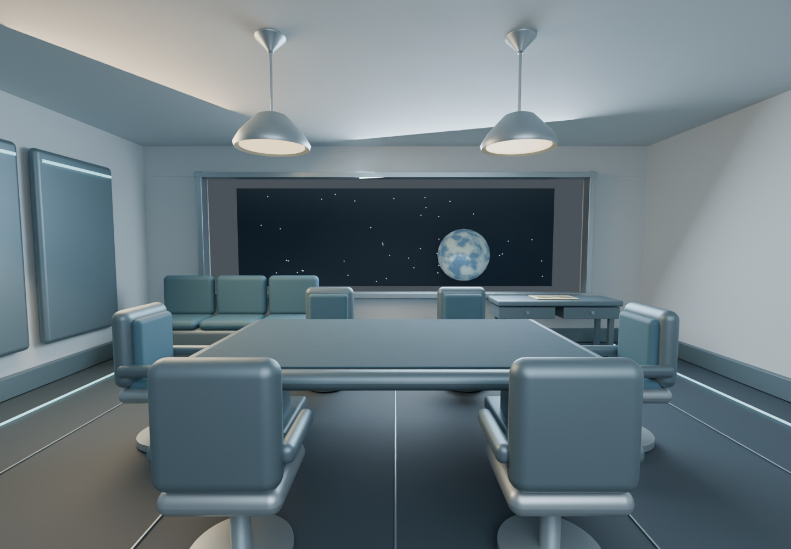

[Lighting detail](mockups/remaining-room-polish-v2/starship-lounge-detail.jpg) ·
[Latest editable source](../../Open-Tabletop_Asset_Builders/3d_models/rooms/starship-lounge/source/starship-lounge-v2.blend) ·
[Polish notes and checks](../../Open-Tabletop_Asset_Builders/3d_models/rooms/README.md)

Earlier v1 views below are retained for comparison.

Soft blue crew seating, brushed alloy panels, cyan coves and a small service console. The banquette makes this an inhabited lounge.

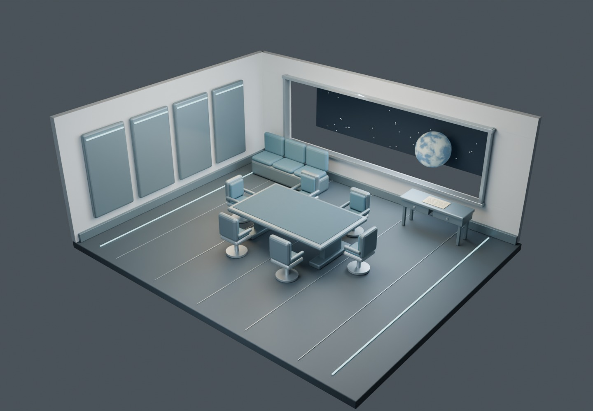

[Seated](mockups/remaining-room-themes-v1/starship-lounge-seated.jpg) · [Reverse](mockups/remaining-room-themes-v1/starship-lounge-reverse.jpg) · [Assets](mockups/remaining-room-themes-v1/starship-lounge-assets.jpg) · [Latest editable source](../../Open-Tabletop_Asset_Builders/3d_models/rooms/starship-lounge/source/starship-lounge-v2.blend)

### Victorian Study

**October 19 polish — ready for review:** Smooth components; two brass wall sconces with frosted tulip shades replace the center pendants.

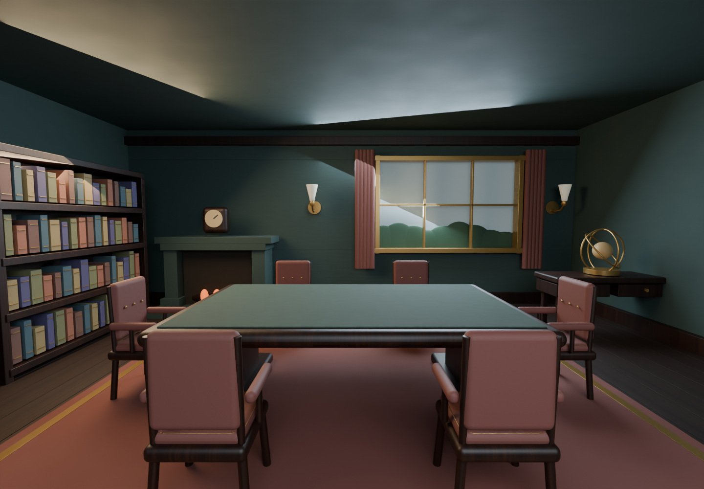

[Lighting detail](mockups/remaining-room-polish-v2/victorian-study-detail.jpg) ·
[Latest editable source](../../Open-Tabletop_Asset_Builders/3d_models/rooms/victorian-study/source/victorian-study-v2.blend) ·
[Polish notes and checks](../../Open-Tabletop_Asset_Builders/3d_models/rooms/README.md)

Earlier v1 views below are retained for comparison.

Walnut library cabinets, oxblood leather armchairs, a carved hearth, heavy drapes and an armillary instrument on a writing desk.

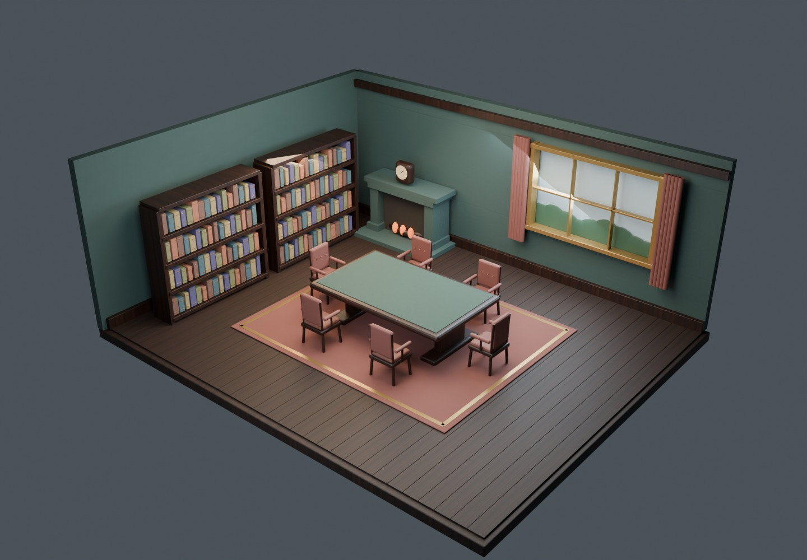

[Seated](mockups/remaining-room-themes-v1/victorian-study-seated.jpg) · [Reverse](mockups/remaining-room-themes-v1/victorian-study-reverse.jpg) · [Assets](mockups/remaining-room-themes-v1/victorian-study-assets.jpg) · [Latest editable source](../../Open-Tabletop_Asset_Builders/3d_models/rooms/victorian-study/source/victorian-study-v2.blend)

### Mountain Cabin

**October 19 polish — ready for review:** Smooth components; pendant stems and smaller conical covers fit the actual timber cross beam.

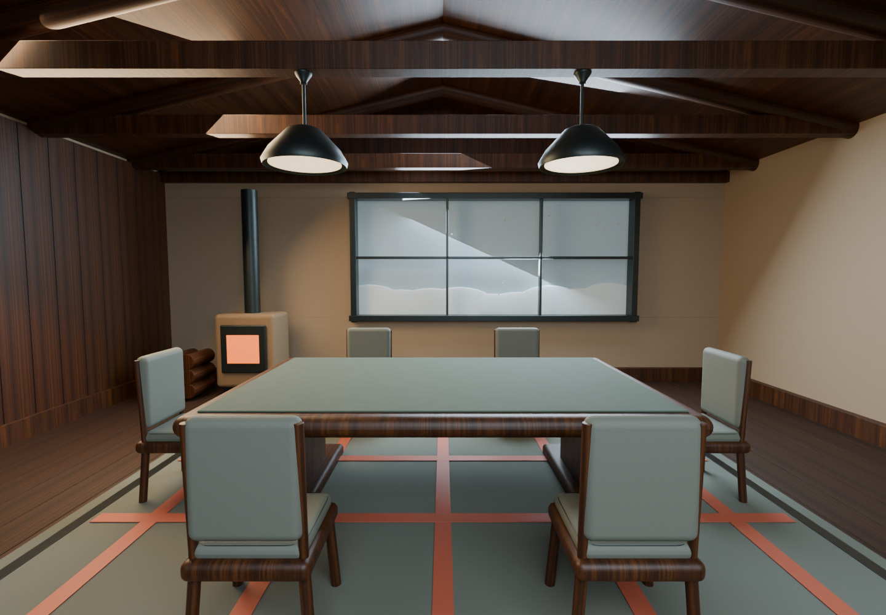

[Lighting detail](mockups/remaining-room-polish-v2/mountain-cabin-detail.jpg) ·
[Latest editable source](../../Open-Tabletop_Asset_Builders/3d_models/rooms/mountain-cabin/source/mountain-cabin-v2.blend) ·
[Polish notes and checks](../../Open-Tabletop_Asset_Builders/3d_models/rooms/README.md)

Earlier v1 views below are retained for comparison.

Pine structure and rafters, wool seating, plaid rug, soapstone stove, stacked logs and a peg rail by the entry.

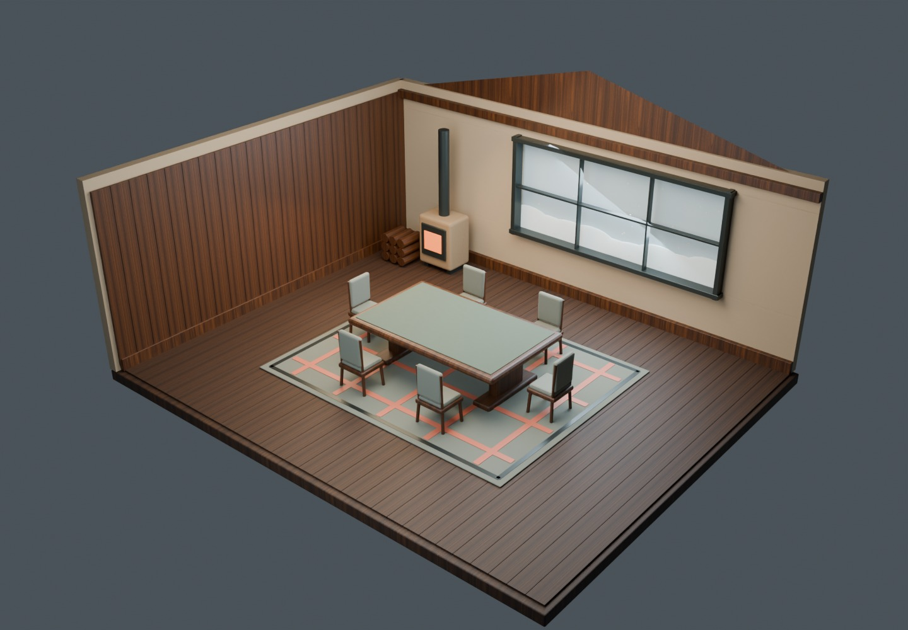

[Seated](mockups/remaining-room-themes-v1/mountain-cabin-seated.jpg) · [Reverse](mockups/remaining-room-themes-v1/mountain-cabin-reverse.jpg) · [Assets](mockups/remaining-room-themes-v1/mountain-cabin-assets.jpg) · [Latest editable source](../../Open-Tabletop_Asset_Builders/3d_models/rooms/mountain-cabin/source/mountain-cabin-v2.blend)

### 1920s Speakeasy

**Approved October 18, 2026.** The owner approved the v4 design after the piping
correction. [Approved source and approval record](../../Open-Tabletop_Asset_Builders/3d_models/rooms/1920s-speakeasy/README.md).
Runtime integration is complete locally; see [runtime captures and checks](PLAN_ROOM_THEMES.md#speakeasy-runtime-integration--october-19-2026).

**October 18 piping correction (v4):** the brass seat piping now follows each
cushion's evaluated bevel contour, including the corners. Seam height, cord
thickness and finish are retained across all six chairs.

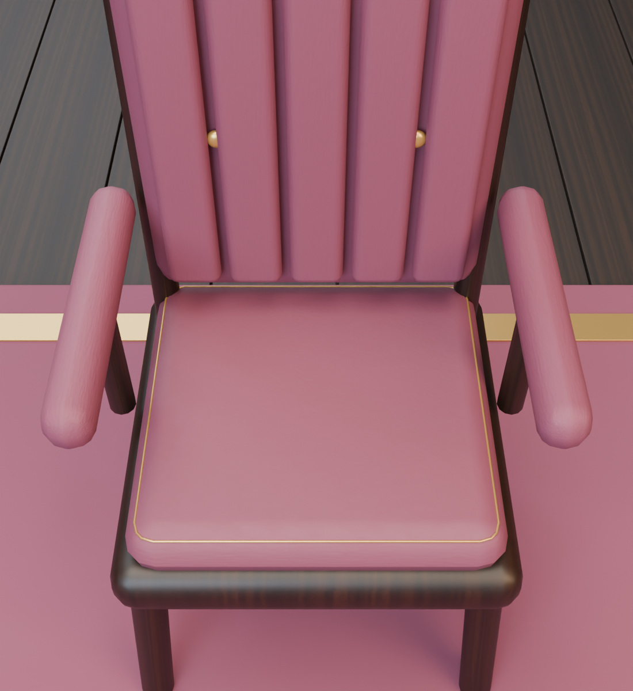

[Side detail](mockups/speakeasy-review-v4/speakeasy-v4-piping-side-detail.jpg) ·
[Latest editable source](../../Open-Tabletop_Asset_Builders/3d_models/rooms/1920s-speakeasy/source/speakeasy-piping-v4.blend) ·
[Revision notes and checks](../../Open-Tabletop_Asset_Builders/3d_models/rooms/1920s-speakeasy/README.md)

The owner accepted the smooth seating and ceiling canopies, then requested this
piping correction. V4 subsequently received owner approval and is now integrated locally.

**October 18 seating and pendant revision (v3):** every mesh part of all six
chairs and the scalloped bench uses smooth shading. Both stems now reach the
ceiling, with tapered metal canopies covering the ceiling connections. The
existing pendant shades retain their height and finish.

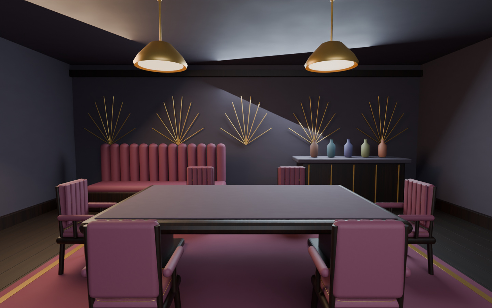

[Seating detail](mockups/speakeasy-review-v3/speakeasy-v3-seating-detail.jpg) ·
[Pendant detail](mockups/speakeasy-review-v3/speakeasy-v3-pendant-detail.jpg) ·
[Latest editable source](../../Open-Tabletop_Asset_Builders/3d_models/rooms/1920s-speakeasy/source/speakeasy-piping-v4.blend) ·
[Revision notes and checks](../../Open-Tabletop_Asset_Builders/3d_models/rooms/1920s-speakeasy/README.md)

The owner accepted the v2 rear-wall appearance and requested this seating/light
revision. Its seating and canopy appearance was accepted before the v4 piping correction.

**October 18 rear-wall revision:** the two smaller fan motifs now flank the
artwork, with explicit clearance from the frame and door. The chart/map sheet
on the desk is a generic placeholder carried over from the shared desk study.

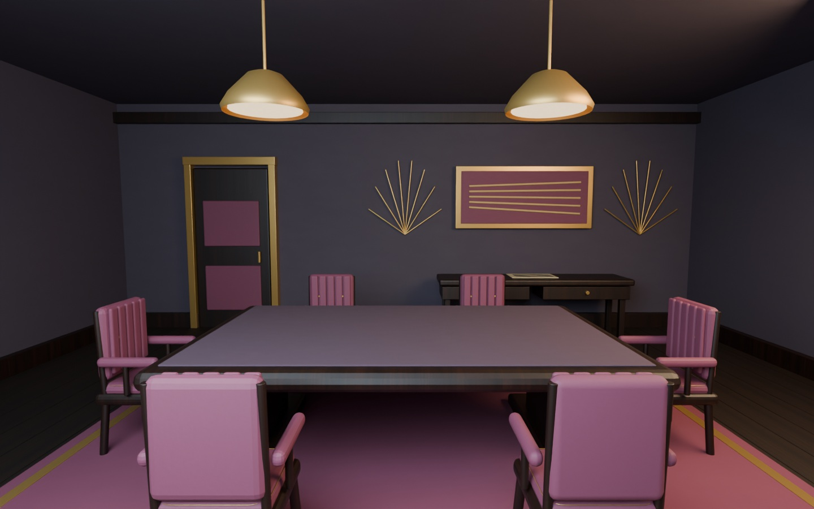

[Wall detail](mockups/speakeasy-review-v2/speakeasy-rear-wall-v2-detail.jpg) ·
[Latest editable source](../../Open-Tabletop_Asset_Builders/3d_models/rooms/1920s-speakeasy/source/speakeasy-piping-v4.blend) ·
[Revision notes and checks](../../Open-Tabletop_Asset_Builders/3d_models/rooms/1920s-speakeasy/README.md)

The v1 room view below remains for comparison. The v2 revision preserved the
live unsaved Blender session; v3 extends that separate source.

Channelled burgundy velvet, a scalloped booth, fan-shaped brass wall inlays, a compact back bar and satin pendant shades.

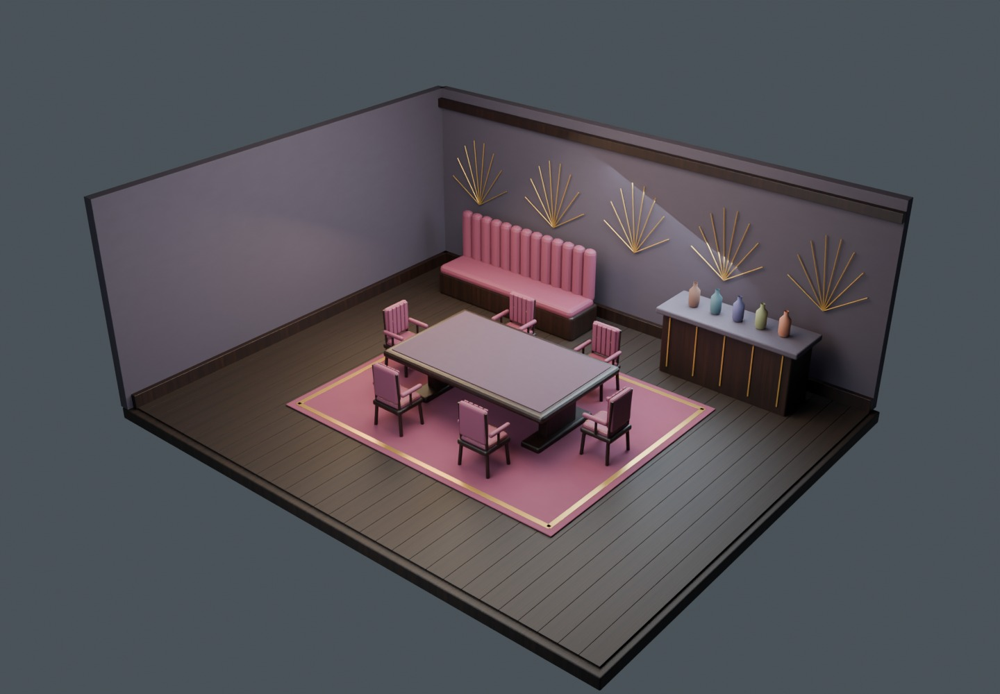

[Seated](mockups/remaining-room-themes-v1/1920s-speakeasy-seated.jpg) · [Reverse](mockups/remaining-room-themes-v1/1920s-speakeasy-reverse.jpg) · [Assets](mockups/remaining-room-themes-v1/1920s-speakeasy-assets.jpg) · [Latest editable source](../../Open-Tabletop_Asset_Builders/3d_models/rooms/1920s-speakeasy/source/speakeasy-piping-v4.blend)

### Pirate Captain's Cabin

**October 19 polish — ready for review:** Smooth components; pendants fit the curved roof rib, and both stern lanterns have wall brackets.

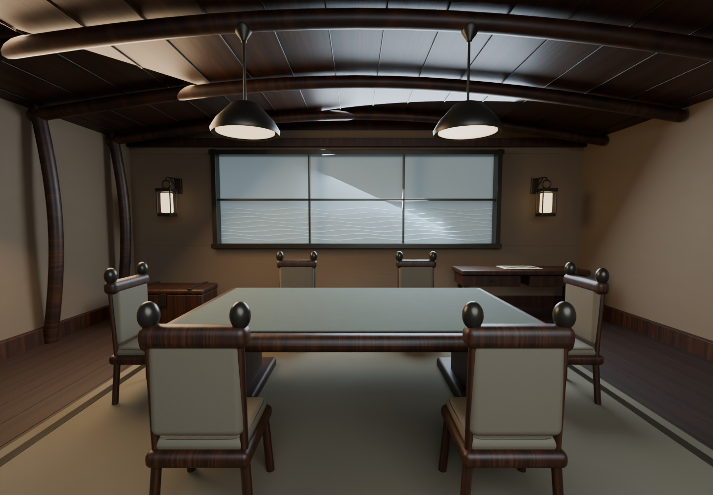

[Lighting detail](mockups/remaining-room-polish-v2/pirate-captains-cabin-detail.jpg) ·
[Latest editable source](../../Open-Tabletop_Asset_Builders/3d_models/rooms/pirate-captains-cabin/source/pirate-captains-cabin-v2.blend) ·
[Polish notes and checks](../../Open-Tabletop_Asset_Builders/3d_models/rooms/README.md)

Earlier v1 views below are retained for comparison.

Ship ribs, brass-bound sea chests, stern windows, carved chair crests, caged lanterns and a chart desk.

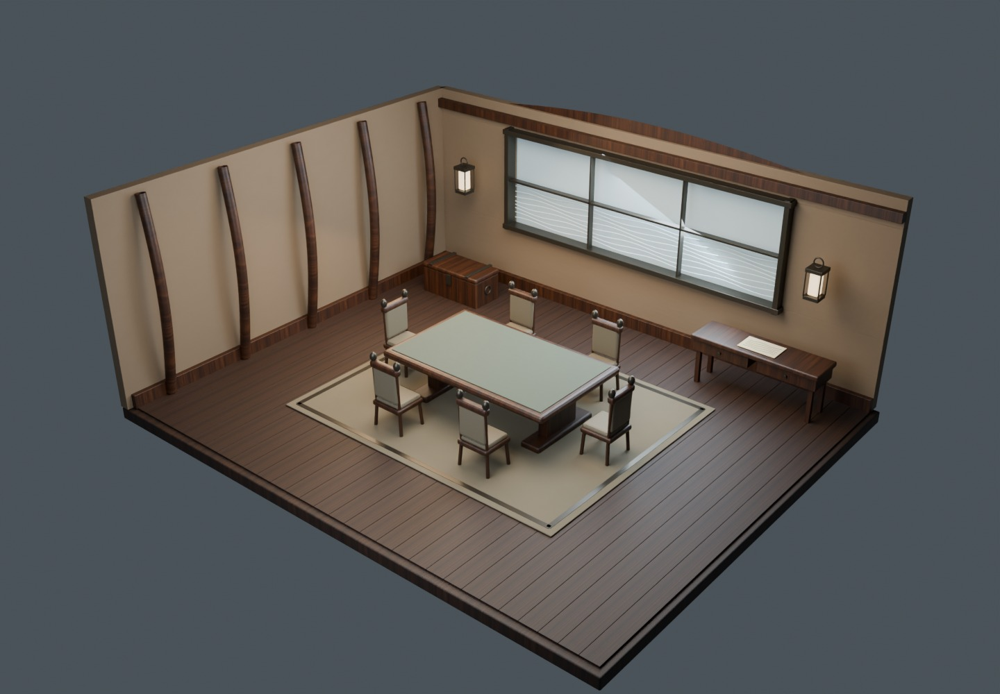

[Seated](mockups/remaining-room-themes-v1/pirate-captains-cabin-seated.jpg) · [Reverse](mockups/remaining-room-themes-v1/pirate-captains-cabin-reverse.jpg) · [Assets](mockups/remaining-room-themes-v1/pirate-captains-cabin-assets.jpg) · [Latest editable source](../../Open-Tabletop_Asset_Builders/3d_models/rooms/pirate-captains-cabin/source/pirate-captains-cabin-v2.blend)

### Wizard's Workshop

**October 19 polish — ready for review:** Smooth components; side-wall bracket lanterns replace the pendants, and the floating rear lantern now has a wall bracket.

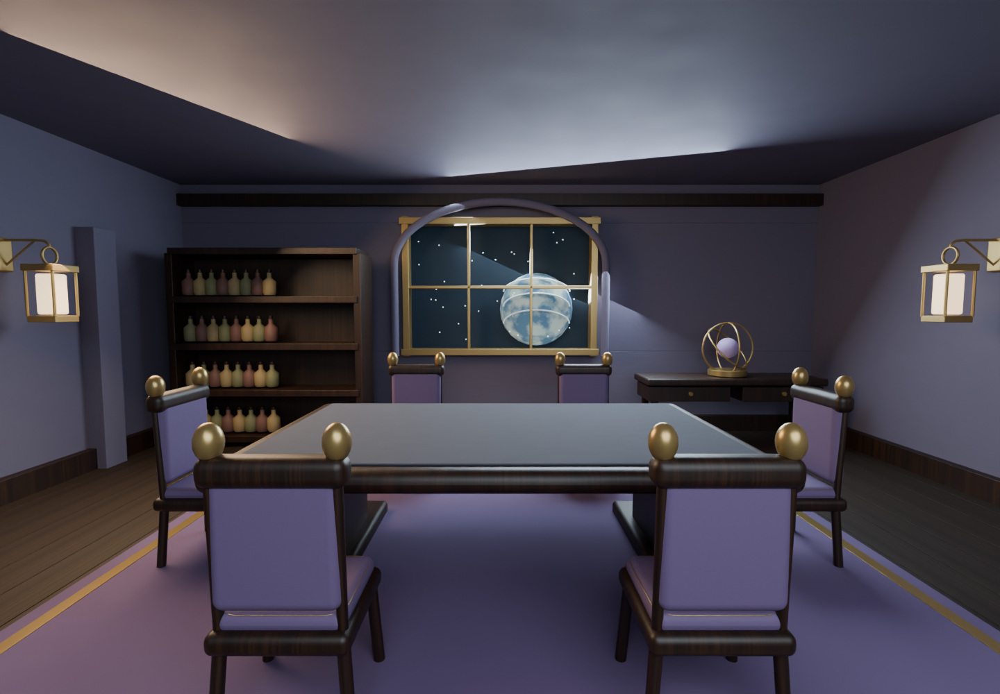

[Lighting detail](mockups/remaining-room-polish-v2/wizards-workshop-detail.jpg) ·
[Rear wall](mockups/remaining-room-polish-v2/wizards-workshop-reverse.jpg) ·
[Latest editable source](../../Open-Tabletop_Asset_Builders/3d_models/rooms/wizards-workshop/source/wizards-workshop-v2.blend) ·
[Polish notes and checks](../../Open-Tabletop_Asset_Builders/3d_models/rooms/README.md)

Earlier v1 views below are retained for comparison.

Stone arches, carved chairs with finials, potion cabinets, book and scroll storage, a brass armillary and a studious violet palette.

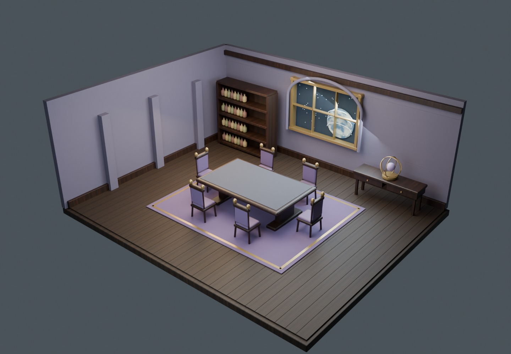

[Seated](mockups/remaining-room-themes-v1/wizards-workshop-seated.jpg) · [Reverse](mockups/remaining-room-themes-v1/wizards-workshop-reverse.jpg) · [Assets](mockups/remaining-room-themes-v1/wizards-workshop-assets.jpg) · [Latest editable source](../../Open-Tabletop_Asset_Builders/3d_models/rooms/wizards-workshop/source/wizards-workshop-v2.blend)

### Cyberpunk Back Room

**Approved October 18, 2026 after the requested pipe fix.** Both upper stubs now
turn 90 degrees upward and pass into the ceiling through small collars. The
suspended fluorescent fixture is retained.

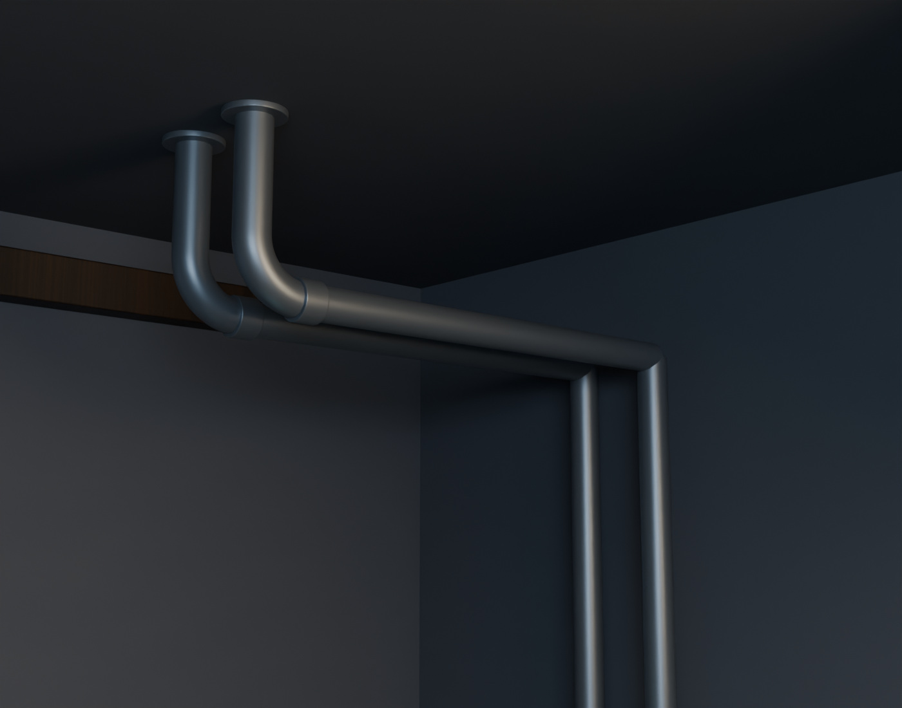

[Room context](mockups/cyberpunk-review-v3/cyberpunk-v3-pipes-reverse.jpg) ·
[Latest editable source](../../Open-Tabletop_Asset_Builders/3d_models/rooms/cyberpunk-back-room/source/cyberpunk-pipe-returns-v3.blend) ·
[Approval record](../../Open-Tabletop_Asset_Builders/3d_models/rooms/_shared/provenance/history/cyberpunk_review_v3/approval.json) ·
[Notes and checks](../../Open-Tabletop_Asset_Builders/3d_models/rooms/cyberpunk-back-room/README.md)

Runtime integration remains pending. The earlier v2 view below documents the
fluorescent fixture before the final pipe returns were added.

**October 18 v2 revision:** a suspended industrial twin-tube fluorescent
fixture replaces the two center pendants. It has a metal reflector, socket
housings and two ceiling-connected suspension cables. At this revision the
utility pipes retained short upper stubs; v3 above completes the requested
upward returns into the ceiling.
The city scene is a staged placeholder for a view outside.

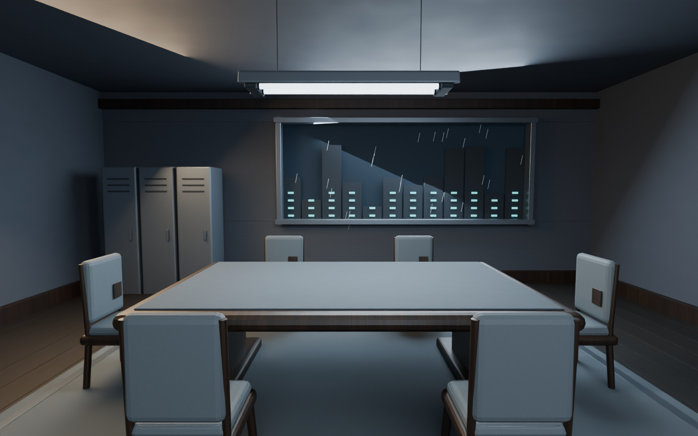

[Fixture detail](mockups/temple-cyberpunk-review-v2/cyberpunk-back-room-v2-detail.jpg) ·
[Latest editable source](../../Open-Tabletop_Asset_Builders/3d_models/rooms/cyberpunk-back-room/source/cyberpunk-pipe-returns-v3.blend) ·
[Revision notes and checks](../../Open-Tabletop_Asset_Builders/3d_models/rooms/cyberpunk-back-room/README.md)

Patched seating, utility lockers, exposed pipes, an unbranded arcade cabinet and rain-streaked city glazing.

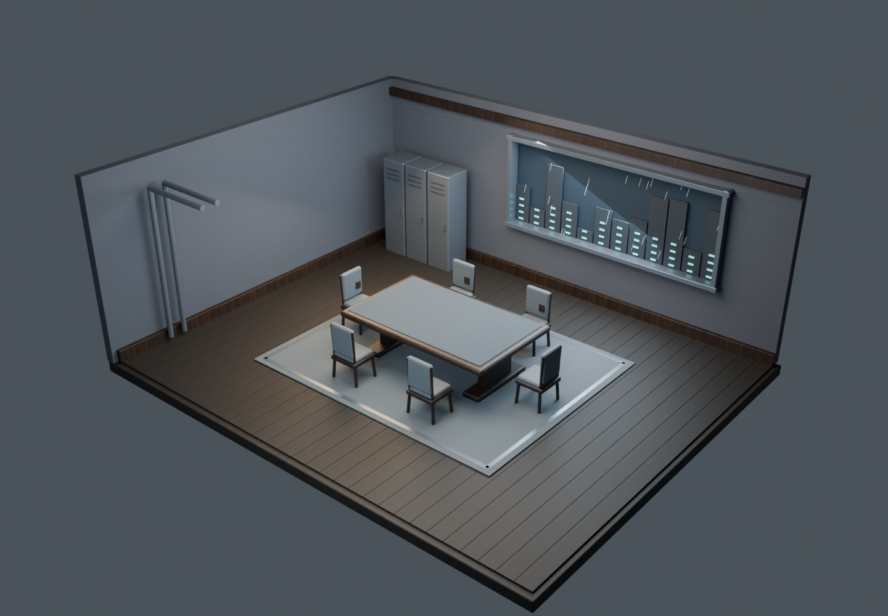

[Seated](mockups/remaining-room-themes-v1/cyberpunk-back-room-seated.jpg) · [Reverse](mockups/remaining-room-themes-v1/cyberpunk-back-room-reverse.jpg) · [Assets](mockups/remaining-room-themes-v1/cyberpunk-back-room-assets.jpg) · [Latest editable source](../../Open-Tabletop_Asset_Builders/3d_models/rooms/cyberpunk-back-room/source/cyberpunk-pipe-returns-v3.blend)

### Japanese Game Café

**V2 plants and chairs approved October 19, 2026.** [Approval record](../../Open-Tabletop_Asset_Builders/3d_models/rooms/japanese-game-cafe/provenance/japanese-game-cafe-approval.json).
The requested global ceiling-connection refinement is supplied as v3, retaining
the approved plants and chair geometry.

[Paper pendant connection](mockups/remaining-room-polish-v2/japanese-game-cafe-detail.jpg) ·
[Latest editable source](../../Open-Tabletop_Asset_Builders/3d_models/rooms/japanese-game-cafe/source/japanese-game-cafe-v3.blend)

**October 18 v2 revision — approved October 19:** a rubber plant and Boston fern
replace the generic plants with curved leaf blades and connected stems. All six
wishbone chairs now have a seat crossrail, central support and branches meeting
the curved back rail. Every mesh uses smooth shading; round chair parts and
bevels have finer geometry.

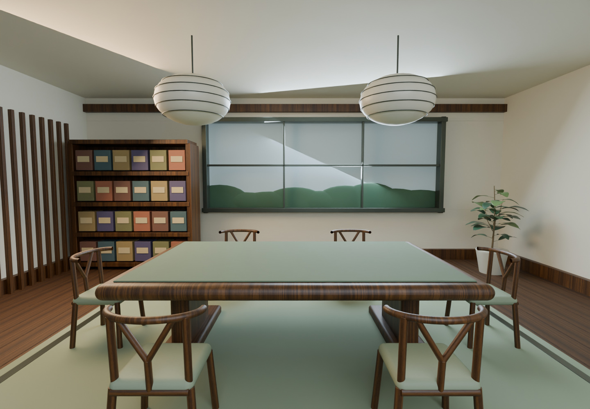

[Connected chair detail](mockups/garden-japanese-review-v2/japanese-game-cafe-v2-detail.jpg) ·
[Reverse view](mockups/garden-japanese-review-v2/japanese-game-cafe-v2-reverse.jpg) ·
[Latest editable source](../../Open-Tabletop_Asset_Builders/3d_models/rooms/japanese-game-cafe/source/japanese-game-cafe-v3.blend) ·
[Notes and checks](../../Open-Tabletop_Asset_Builders/3d_models/rooms/README.md)

The v1 view below remains for comparison.

Pale oak, bow-back chairs, shelves of unbranded game boxes, a slatted divider, paper pendants, a coffee counter and plants.

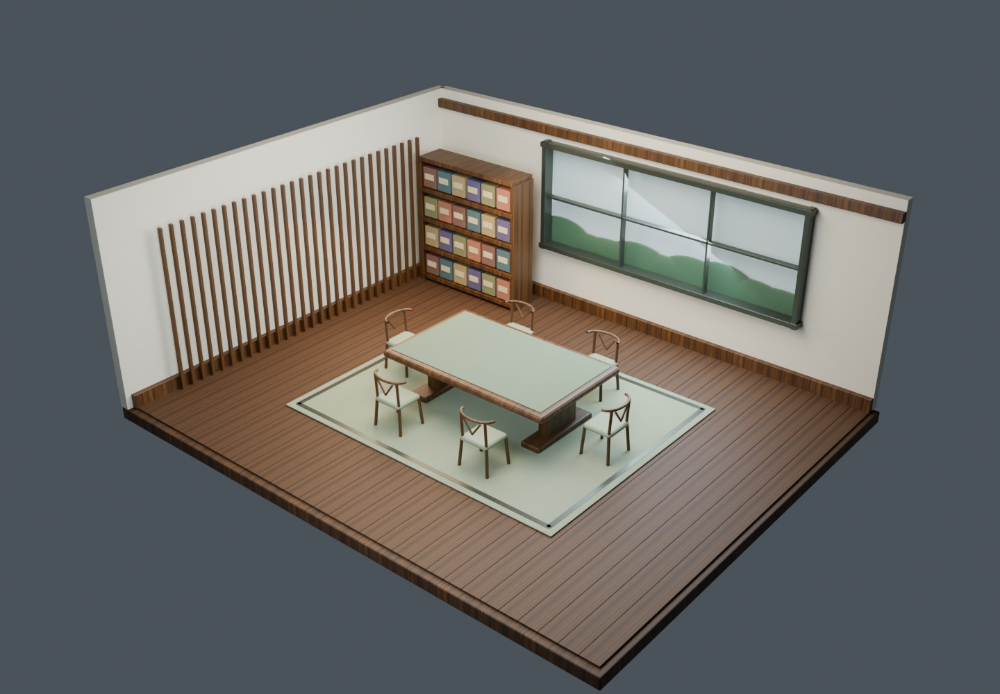

[Seated](mockups/remaining-room-themes-v1/japanese-game-cafe-seated.jpg) · [Reverse](mockups/remaining-room-themes-v1/japanese-game-cafe-reverse.jpg) · [Assets](mockups/remaining-room-themes-v1/japanese-game-cafe-assets.jpg) · [Latest editable source](../../Open-Tabletop_Asset_Builders/3d_models/rooms/japanese-game-cafe/source/japanese-game-cafe-v3.blend)

### Garden Conservatory

**Approved October 19, 2026.** [Approval record](../../Open-Tabletop_Asset_Builders/3d_models/rooms/_shared/provenance/history/garden_japanese_review_v2/garden-conservatory-approval.json).

**October 18 v2 revision — approved October 19:** areca palm, rubber plant, Boston
fern, snake plant and peace lily provide five distinct planted forms, alongside a
rebuilt climbing vine. Curved blades, tapered stems and varied growth replace
flattened oval foliage. The moved fern's complete foliage clears the desk by
about 66 cm. All mesh parts use smooth shading, with finer bevels and round
chair geometry.

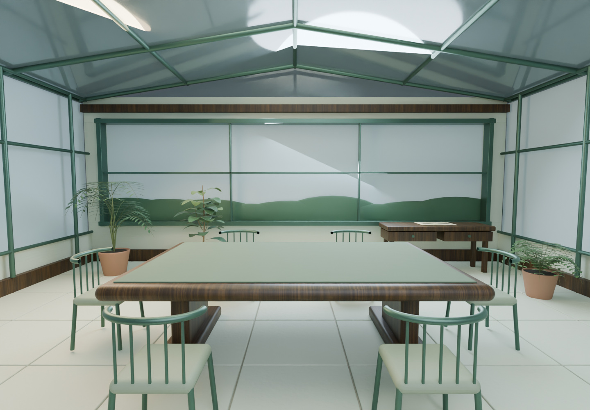

[Desk and fern clearance](mockups/garden-japanese-review-v2/garden-conservatory-v2-detail.jpg) ·
[Other plant varieties and vine](mockups/garden-japanese-review-v2/garden-conservatory-v2-reverse.jpg) ·
[Latest editable source](../../Open-Tabletop_Asset_Builders/3d_models/rooms/garden-conservatory/source/garden-conservatory-v2.blend) ·
[Notes and checks](../../Open-Tabletop_Asset_Builders/3d_models/rooms/README.md)

The v1 view below remains for comparison.

Green ironwork, roof trusses, slim garden chairs with linen pads, terracotta planters, trellis vines and a potting console.

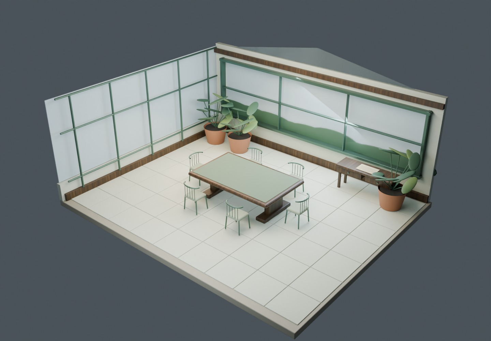

[Seated](mockups/remaining-room-themes-v1/garden-conservatory-seated.jpg) · [Reverse](mockups/remaining-room-themes-v1/garden-conservatory-reverse.jpg) · [Assets](mockups/remaining-room-themes-v1/garden-conservatory-assets.jpg) · [Latest editable source](../../Open-Tabletop_Asset_Builders/3d_models/rooms/garden-conservatory/source/garden-conservatory-v2.blend)

### Ancient Temple

**Approved October 18, 2026.** The approved source is v2 with smooth shading.
[Approval record](../../Open-Tabletop_Asset_Builders/3d_models/rooms/_shared/provenance/history/temple_cyberpunk_review_v2/ancient-temple-approval.json).
Integrated locally; see [runtime views and checks](PLAN_ROOM_THEMES.md#ancient-temple-runtime-integration--october-19-2026).

**October 18 v2 revision:** all mesh parts use smooth shading and rounded
bevels use six segments. The blue panel behind the columns stands in for a
landscape view through a broad exterior opening; it is not an interior blue wall.

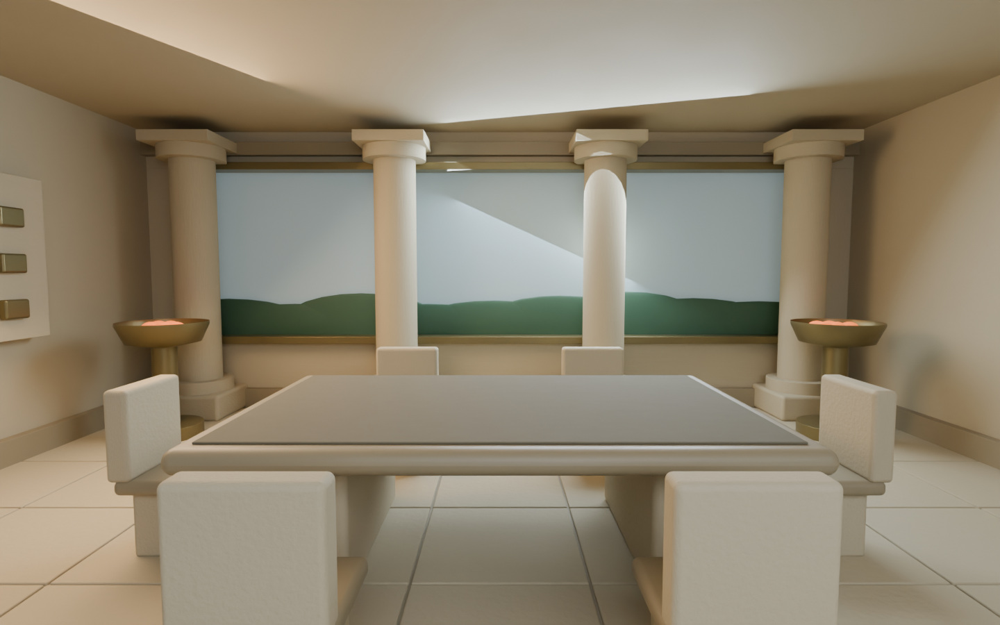

[Component detail](mockups/temple-cyberpunk-review-v2/ancient-temple-v2-detail.jpg) ·
[Latest editable source](../../Open-Tabletop_Asset_Builders/3d_models/rooms/ancient-temple/source/ancient-temple-v2.blend) ·
[Revision notes and checks](../../Open-Tabletop_Asset_Builders/3d_models/rooms/cyberpunk-back-room/README.md)

Weathered sandstone, monumental columns and capitals, stone seats, braziers, abstract relief panels and a broad landscape opening.

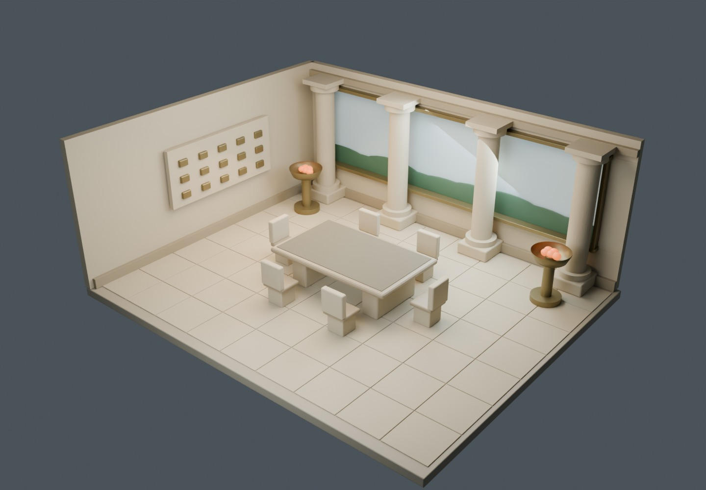

[Seated](mockups/remaining-room-themes-v1/ancient-temple-seated.jpg) · [Reverse](mockups/remaining-room-themes-v1/ancient-temple-reverse.jpg) · [Assets](mockups/remaining-room-themes-v1/ancient-temple-assets.jpg) · [Latest editable source](../../Open-Tabletop_Asset_Builders/3d_models/rooms/ancient-temple/source/ancient-temple-v2.blend)

### Orbital Observation Deck

**October 19 polish — ready for review:** Smooth components and finer rounded details; this room has no pendant fixtures.

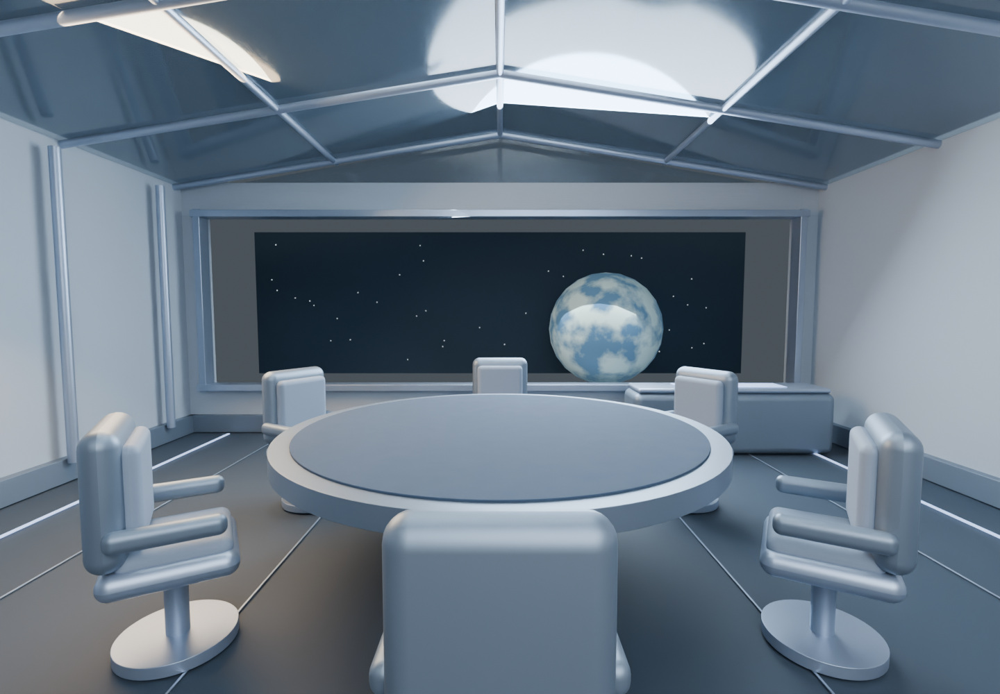

[Latest editable source](../../Open-Tabletop_Asset_Builders/3d_models/rooms/orbital-observation-deck/source/orbital-observation-deck-v2.blend) ·
[Polish notes and checks](../../Open-Tabletop_Asset_Builders/3d_models/rooms/README.md)

Earlier v1 views below are retained for comparison.

A wide planetary panorama, exposed roof ribs, minimal blue-gray seating, a low observation console and subtle floor guides.

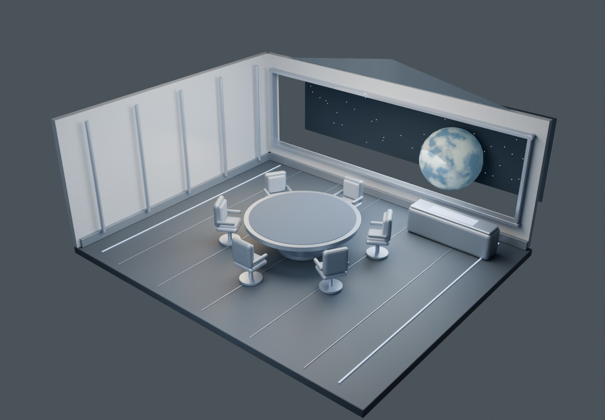

[Seated](mockups/remaining-room-themes-v1/orbital-observation-deck-seated.jpg) · [Reverse](mockups/remaining-room-themes-v1/orbital-observation-deck-reverse.jpg) · [Assets](mockups/remaining-room-themes-v1/orbital-observation-deck-assets.jpg) · [Latest editable source](../../Open-Tabletop_Asset_Builders/3d_models/rooms/orbital-observation-deck/source/orbital-observation-deck-v2.blend)

## Local room asset organization (October 19, 2026)

The current native sources are consolidated in the final-room package. Superseded editable drafts and asset boards were deleted after preserving the latest sources, owner snapshots and revision records. Older pictures on this page remain dated review evidence; editable-source links now open the latest version. [Open the final-room index](../../Open-Tabletop_Asset_Builders/3d_models/rooms/README.md).
