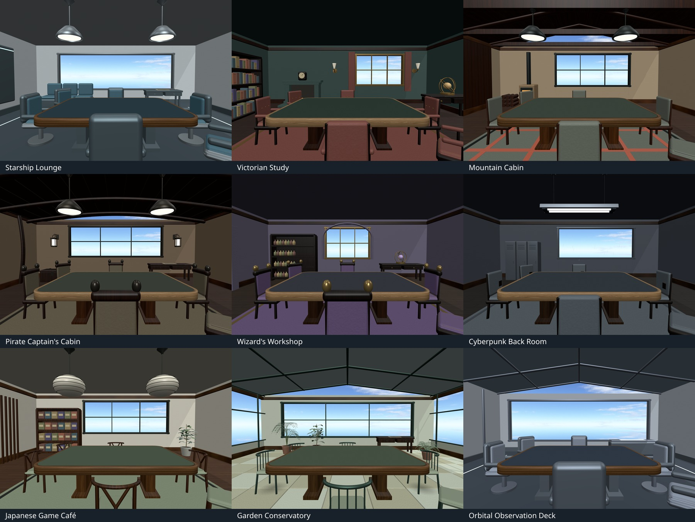

# Integrated room review — October 19, 2026

All eleven reviewed themes are now integrated locally: Speakeasy and Ancient
Temple from the earlier slices, plus the nine rooms below. The owner authorized
batch integration and will perform final in-app review. This does not mark that
manual acceptance complete.

Apply all pending numbered migrations through the configured migration role,
including **`030_remaining_room_themes.sql`**, then restart the server and
hard-refresh clients. Fresh installs include the full ledger in `schema.sql`.
In **Room Settings → Table Size & Color → Room style**, select each theme. The
native select contains **16** choices, including Standard and the original rooms.
**Use matching table** applies the wood/felt pair below; selecting a room alone
preserves table finish, shape, size, sky and lighting. Existing click, keyboard
and touch controls apply. No new icon, gesture or input intent is added.

[Overhead contact sheet](mockups/remaining-rooms-runtime-v1/contact-overview.jpg) ·
[Rear-wall contact sheet](mockups/remaining-rooms-runtime-v1/contact-reverse.jpg)

| Room | Saved ID | Models | Compressed bytes | Optional table match |
| --- | --- | ---: | ---: | --- |
| Starship Lounge | `starship-lounge` | 8 | 2,558,932 | Oak / `#304c58` |
| Victorian Study | `victorian-study` | 7 | 10,981,880 | Walnut / `#32493f` |
| Mountain Cabin | `mountain-cabin` | 8 | 4,253,856 | Oak / `#4d5c4f` |
| Pirate Captain's Cabin | `pirate-captains-cabin` | 8 | 4,009,056 | Walnut / `#4b5549` |
| Wizard's Workshop | `wizards-workshop` | 7 | 8,931,684 | Walnut / `#424652` |
| Cyberpunk Back Room | `cyberpunk-back-room` | 7 | 2,562,336 | Walnut / `#3c4851` |
| Japanese Game Café | `japanese-game-cafe` | 8 | 10,532,796 | Oak / `#61745e` |
| Garden Conservatory | `garden-conservatory` | 7 | 15,675,216 | Oak / `#5c705b` |
| Orbital Observation Deck | `orbital-observation-deck` | 6 | 1,939,948 | Oak / `#3c4c60` |

These are real production-renderer captures with six occupied seats, the existing
playable table and an explicitly selected Cloudy - Clear Afternoon sky in an
isolated review fixture. The themes retain the room's saved sky and lighting;
exterior study panels, city/planet/foliage dioramas and staging lights are excluded.
The source's bespoke stone/metal tabletops do not replace the physics-owned table.

| Room | Seated | Rear wall | Overhead |
| --- | --- | --- | --- |
| Starship Lounge | [View](mockups/remaining-rooms-runtime-v1/starship-lounge-seated.jpg) | [View](mockups/remaining-rooms-runtime-v1/starship-lounge-reverse.jpg) | [View](mockups/remaining-rooms-runtime-v1/starship-lounge-overview.jpg) |
| Victorian Study | [View](mockups/remaining-rooms-runtime-v1/victorian-study-seated.jpg) | [View](mockups/remaining-rooms-runtime-v1/victorian-study-reverse.jpg) | [View](mockups/remaining-rooms-runtime-v1/victorian-study-overview.jpg) |
| Mountain Cabin | [View](mockups/remaining-rooms-runtime-v1/mountain-cabin-seated.jpg) | [View](mockups/remaining-rooms-runtime-v1/mountain-cabin-reverse.jpg) | [View](mockups/remaining-rooms-runtime-v1/mountain-cabin-overview.jpg) |
| Pirate Captain's Cabin | [View](mockups/remaining-rooms-runtime-v1/pirate-captains-cabin-seated.jpg) | [View](mockups/remaining-rooms-runtime-v1/pirate-captains-cabin-reverse.jpg) | [View](mockups/remaining-rooms-runtime-v1/pirate-captains-cabin-overview.jpg) |
| Wizard's Workshop | [View](mockups/remaining-rooms-runtime-v1/wizards-workshop-seated.jpg) | [View](mockups/remaining-rooms-runtime-v1/wizards-workshop-reverse.jpg) | [View](mockups/remaining-rooms-runtime-v1/wizards-workshop-overview.jpg) |
| Cyberpunk Back Room | [View](mockups/remaining-rooms-runtime-v1/cyberpunk-back-room-seated.jpg) | [View](mockups/remaining-rooms-runtime-v1/cyberpunk-back-room-reverse.jpg) | [View](mockups/remaining-rooms-runtime-v1/cyberpunk-back-room-overview.jpg) |
| Japanese Game Café | [View](mockups/remaining-rooms-runtime-v1/japanese-game-cafe-seated.jpg) | [View](mockups/remaining-rooms-runtime-v1/japanese-game-cafe-reverse.jpg) | [View](mockups/remaining-rooms-runtime-v1/japanese-game-cafe-overview.jpg) |
| Garden Conservatory | [View](mockups/remaining-rooms-runtime-v1/garden-conservatory-seated.jpg) | [View](mockups/remaining-rooms-runtime-v1/garden-conservatory-reverse.jpg) | [View](mockups/remaining-rooms-runtime-v1/garden-conservatory-overview.jpg) |
| Orbital Observation Deck | [View](mockups/remaining-rooms-runtime-v1/orbital-observation-deck-seated.jpg) | [View](mockups/remaining-rooms-runtime-v1/orbital-observation-deck-reverse.jpg) | [View](mockups/remaining-rooms-runtime-v1/orbital-observation-deck-overview.jpg) |

During review, occupy different seats, pan to the rear walls and move overhead to
check cutaways. Inspect the connected canopy/stems and Cyberpunk fluorescent
fixture/pipe returns, Victorian sconces, Wizard wall lanterns, Japanese wishbone
joints and varied Conservatory plants. Try a large round or wide hex table to
check seating room. Reload once to confirm persistence, and check from a second
client when available. These manual checks remain yours to approve.

Conservatory has extra room clearance around its full foliage bounds and side
iron frames that span the resized glazing. Floors have
opaque backing under tile/plank joints. The Victorian clock rests on its mantel,
and its instrument desk is inset clear of the east wall. Authored native sources
remain unchanged. [Implementation, complete file inventory and checks](PLAN_ROOM_THEMES.md#remaining-nine-room-integrations--october-19-2026).

Automated verification passes: **1,374** code tests plus lint/format/CSS, all
**215** model profiles on desktop/touch, **25** database tests, **seven** device
profiles, the full component suite and focused Conservatory floor/frame checks.
The component suite retains the existing `/favicon.ico` 404. These checks do not
mark final owner in-app acceptance, actual-phone performance or real multiplayer
play testing complete. All earlier model records and native source hashes remain
unchanged; no push/deployment or owner database migration was performed.

## Local room asset organization (October 19, 2026)

Final Blender sources, the exact 82 raw/optimized room models, textures, previews and provenance are consolidated in the companion final-room package. Source relocation does not change the installed app. The pack includes a read-only integrity verifier and relocated offline exporter tools. [Open the final-room index](../../Open-Tabletop_Asset_Builders/3d_models/rooms/README.md).
